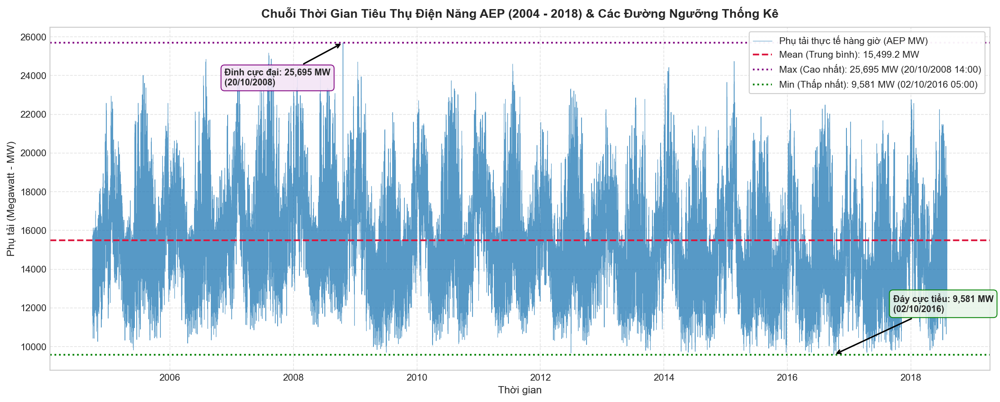
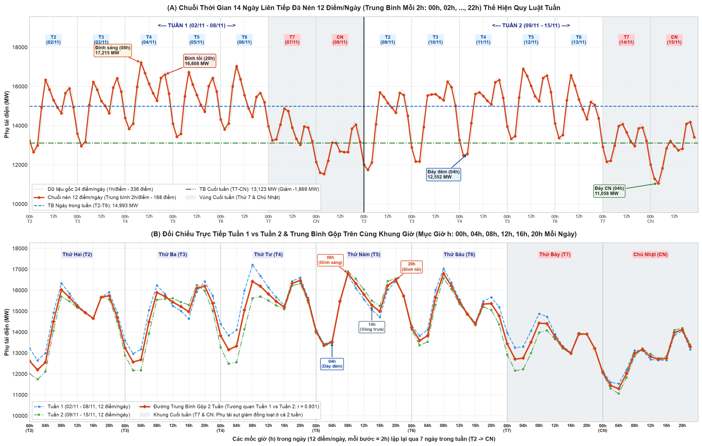
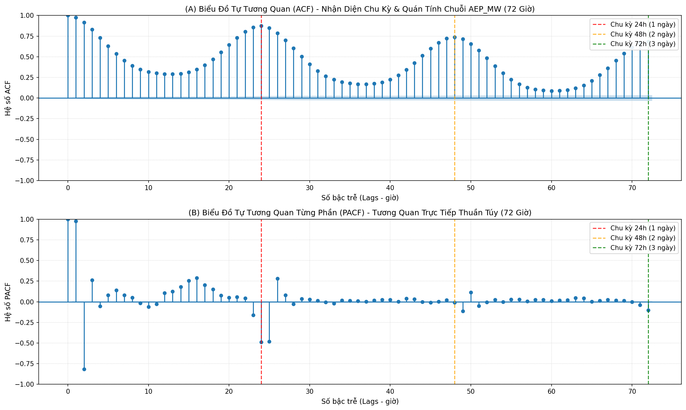

# Tiền Xử Lý & Khám Phá Dữ Liệu Chuỗi Thời Gian (Data Preparation & EDA)

Tài liệu này chi tiết hóa toàn bộ quy trình kiểm tra chất lượng dữ liệu, xử lý tính liên tục thời gian (Daylight Saving Time, mốc trùng lặp / thiếu hụt), thống kê mô tả (`describe`) và phân tích trực quan hóa chuỗi dữ liệu tiêu thụ điện **AEP Hourly Energy Consumption** được triển khai trong notebook [`notebooks/main.ipynb`](../notebooks/main.ipynb).

---

## 1. Giới Thiệu Tập Dữ Liệu AEP Hourly

* **Nguồn dữ liệu:** PJM Interconnection LLC (Dataset: [Hourly Energy Consumption - AEP](https://www.kaggle.com/datasets/robikscube/hourly-energy-consumption?select=AEP_hourly.csv)).
* **Đơn vị quản trị:** American Electric Power (AEP) - hệ thống điện lưới phụ tải lớn tại miền Đông Bắc Hoa Kỳ.
* **Thời gian quan sát:** Từ **01/10/2004 01:00:00** đến **03/08/2018 00:00:00** (~14 năm liên tục).
* **Đơn vị đo lường:** Megawatt ($MW$).
* **Đặc tính chuỗi:** Chuỗi thời gian đơn biến $y_t$ có tần suất hàng giờ (`Hourly`), chu kỳ ngày (24 giờ), chu kỳ tuần (168 giờ) và chu kỳ mùa trong năm.

---

## 2. Kiểm Tra Chất Lượng Dữ Liệu & Tiền Xử Lý Dòng Thời Gian

### 2.1. Đánh giá hiện trạng dữ liệu thô
* Kích thước file ban đầu: **121.273 dòng** và **2 cột** (`Datetime`, `AEP_MW`).
* Giá trị khuyết thiếu ban đầu: **0 giá trị NaN**.
* **Vấn đề trật tự thời gian (Non-monotonic):** Dữ liệu thô bị đảo lộn thứ tự ngày tháng (ví dụ: ngày `2004-12-31` nằm trước ngày `2004-12-30`).  
  👉 **Giải pháp:** Bắt buộc sắp xếp lại dòng thời gian tăng dần tuyệt đối:
  ```python
  df['Datetime'] = pd.to_datetime(df['Datetime'])
  df = df.sort_values('Datetime').reset_index(drop=True)
  ```

### 2.2. Xử lý hiện tượng Quy ước giờ mùa hè (Daylight Saving Time - DST)
Chuỗi thời gian thực tế tại Bắc Mỹ chịu ảnh hưởng của DST với 2 hiện tượng vật lý:

1. **Trùng lặp mốc thời gian (Fall Back - Lùi 1 giờ vào mùa thu):**  
   Chủ nhật đầu tiên của tháng 11 hàng năm, đồng hồ lùi từ 02:00 sáng về 01:00 sáng, dẫn đến giờ `02:00:00` xuất hiện 2 lần:
   * `2014-11-02 02:00:00`: $12.994\text{ MW}$ và $13.190\text{ MW}$
   * `2015-11-01 02:00:00`: $10.785\text{ MW}$ và $10.542\text{ MW}$
   * `2016-11-06 02:00:00`: $10.964\text{ MW}$ và $11.008\text{ MW}$
   * `2017-11-05 02:00:00`: $10.596\text{ MW}$ và $10.446\text{ MW}$  
   👉 **Giải pháp:** Nhóm theo `Datetime` và tính trung bình phụ tải của 2 lần đo: `df.groupby('Datetime')['AEP_MW'].mean()`.

2. **Khuyết mốc thời gian (Spring Forward - Nhảy cóc 1 giờ vào mùa xuân):**  
   Vào tháng 3 hàng năm, đồng hồ nhảy từ 02:00 sáng sang 03:00 sáng, làm khuyết mốc `02:00:00`. Tổng số giờ dự kiến liên tục trong 14 năm là **121.296 giờ**, trong khi dữ liệu thực tế chỉ có 121.269 mốc duy nhất (thiếu **27 giờ** $\approx 0.022\%$).  
   👉 **Giải pháp:** Thiết lập lưới thời gian liên tục với tần suất 1 giờ (`asfreq('h')`) và nội suy tuyến tính theo thời gian:
   ```python
   series = df.groupby('Datetime')['AEP_MW'].mean().asfreq('h')
   series = series.interpolate(method='time')
   ```

* **Kết quả:** Thu được chuỗi thời gian sạch hoàn hảo với **121.296 quan sát liên tục**, không có giá trị khuyết và khoảng cách giữa các bước luôn đúng $1\text{ giờ}$.

---

## 3. Thống Kê Mô Tả Chuỗi Phụ Tải (`describe`)

Kết quả thống kê mô tả từ hàm `series.describe()` trên toàn bộ chuỗi $y_t$:

| Chỉ số thống kê | Giá trị ($MW$) | Diễn giải & Ý nghĩa nghiệp vụ |
|---|---|---|
| **Số quan sát (Count)** | **121.296 giờ** | Chuỗi đầy đủ liên tục 100% trong suốt ~14 năm (2004–2018). |
| **Giá trị trung bình (Mean)** | **15.499,15 MW** | Mức tiêu thụ điện năng bình quân của lưới điện AEP. |
| **Độ lệch chuẩn (Std)** | **2.591,38 MW** | Biên độ dao động lớn phản ánh sự chênh lệch phụ tải ngày/đêm và mùa hè/mùa đông. |
| **Thấp nhất (Min)** | **9.581,00 MW** | Đáy cực tiểu xuất hiện vào lúc `02/10/2016 05:00:00` (đêm thời tiết ôn hòa, thấp điểm). |
| **Tứ phân vị 25% (Q1)** | **13.629,00 MW** | 25% thời gian trong 14 năm phụ tải dưới mức này (chủ yếu là đêm và cuối tuần). |
| **Trung vị 50% (Median)** | **15.309,00 MW** | Rất gần với Mean ($15.499\text{ MW}$), phân phối phụ tải mang tính cân xứng tốt. |
| **Tứ phân vị 75% (Q3)** | **17.200,00 MW** | 75% thời gian phụ tải không vượt quá $17.200\text{ MW}$. |
| **Cao nhất (Max)** | **25.695,00 MW** | Đỉnh cực đại kỷ lục đạt vào lúc `20/10/2008 14:00:00` (đợt rét đậm bất thường). |

---

## 4. Trực Quan Hóa Dữ Liệu & Chú Thích Biểu Đồ

### 4.1. Toàn cảnh chuỗi thời gian & Các đường ngưỡng thống kê



* **Đường Mean (đỏ nét đứt):** Mức trung bình $15.499,2\text{ MW}$ duy trì vững chắc qua 14 năm, cho thấy nhu cầu phụ tải nền (Base Load) rất ổn định.
* **Đường Max (tím nét chấm):** Ngưỡng $25.695\text{ MW}$ và các đợt đỉnh mùa đông lạnh cực đoan (Polar Vortex) chứng minh các giá trị ngoại lai này mang bản chất vật lý thật của thời tiết, cần được giữ lại trong tập huấn luyện.
* **Đường Min (xanh lá nét chấm):** Ngưỡng $9.581\text{ MW}$ thể hiện mức sàn tiêu thụ điện tối thiểu của vùng.
* **Tính mùa vụ lặp lại:** Chu kỳ 1 năm lặp đi lặp lại rất rõ rệt với 2 đỉnh phụ tải (mùa đông sưởi ấm và mùa hè làm mát).

---

### 4.2. Thu phóng 14 ngày (2 tuần) nén 12 điểm/ngày (`2h`): Nhịp điệu theo giờ (`h`) & Quy luật tuần



Để triệt tiêu nhiễu ngắn hạn từng giờ và làm nổi bật quy luật chu kỳ, chuỗi 14 ngày liên tục (2 tuần trọn vẹn từ Thứ Hai `02/11/2009` đến Chủ Nhật `15/11/2009`) được nén từ 24 điểm/ngày xuống **12 điểm/ngày** bằng cách lấy trung bình mỗi cụm 2 giờ (`resample('2h').mean()`, tương ứng các mốc giờ: `00h, 02h, 04h, 06h, 08h, 10h, 12h, 14h, 16h, 18h, 20h, 22h`):

1. **Chu kỳ hàng ngày theo từng mốc giờ (`h`) — 12 điểm/ngày:**
   - **Đáy đêm (`04h`):** Phụ tải tụt sâu nhất vào khoảng `02h–04h` sáng ($\sim 12.550 - 13.500\text{ MW}$) khi hoạt động sản xuất và dân sinh nghỉ ngơi.
   - **Đỉnh sáng (`08h`):** Phụ tải tăng vọt lên đỉnh thứ nhất lúc `08h` sáng ($\sim 16.500 - 17.215\text{ MW}$) khi các nhà máy, văn phòng và nhu cầu sưởi ấm khởi động.
   - **Võng trưa (`14h`):** Phụ tải hạ nhiệt nhẹ vào khung giờ trưa – đầu giờ chiều (`12h–16h`).
   - **Đỉnh tối (`20h`):** Phụ tải bật tăng trở lại đạt đỉnh thứ hai lúc `18h–20h` tối ($\sim 16.200 - 16.608\text{ MW}$) do nhu cầu chiếu sáng và sinh hoạt gia đình.
2. **Quy luật hàng tuần cực mạnh (Weekly 168-hour cycle, tương quan $r = 0,931$):**
   - **Panel (A) - Chuỗi 14 ngày liên tiếp:** Ở cả **Tuần 1** và **Tuần 2**, 5 ngày làm việc (`T2` $\rightarrow$ `T6`) giữ mức tiêu thụ trung bình cao **$14.993\text{ MW}$**, trong khi hai ngày nghỉ cuối tuần (`T7 & CN` - vùng tô xám) đồng loạt sụt giảm xuống mức trung bình **$13.123\text{ MW}$** (giảm trung bình **$-1.869\text{ MW}$**).
   - **Panel (B) - Đối chiếu trực tiếp Tuần 1 vs Tuần 2 & Trung bình gộp 2 tuần trên 84 mốc (`7 ngày × 12 mốc giờ/ngày`):** Khi xếp chồng **Tuần 1**, **Tuần 2** và **Đường trung bình gộp 2 tuần** theo đúng các mốc giờ (`00h, 04h, 08h, 12h, 16h, 20h`) của từng thứ trong tuần (`T2 -> CN`), hai đường tuần gần như trùng khít lên nhau với hệ số tương quan Pearson đạt **$r = 0,931$**. Đây là bằng chứng trực quan rõ nhất lý giải vì sao việc bổ sung cụm biến trễ tuần (`lag_167`, `lag_168`, `lag_169`) cùng chuỗi `lag_1..24` lại giúp mô hình XGBoost dự báo chính xác cả nhịp ngày lẫn nhịp tuần.

---

## 5. Cơ Sở Lý Thuyết Biến Đổi Chuỗi Thời Gian Sang Học Có Giám Sát

### 5.1. Bản chất toán học của bài toán
Trong bài toán chuỗi thời gian đơn biến cổ điển, ta có một dãy các quan sát theo thứ tự thời gian:
$$y_1, y_2, y_3, \dots, y_T$$

Mô hình Machine Learning (như XGBoost, Random Forest, Linear Regression) yêu cầu dữ liệu đầu vào dạng bảng có cấu trúc ma trận gồm tập đặc trưng đầu vào $X \in \mathbb{R}^{N \times p}$ và vector nhãn mục tiêu $y \in \mathbb{R}^N$.

Kỹ thuật **Trượt cửa sổ thời gian (Sliding Window / Lagging)** chuyển đổi bài toán dự báo bước tiếp theo thành bài toán hồi quy có giám sát:
$$\hat{y}_t = f(y_{t-1}, y_{t-2}, \dots, y_{t-p})$$

Trong đó:
* $y_t$ (**Biến mục tiêu / Target**): Giá trị phụ tải tại thời điểm $t$ cần dự báo.
* $y_{t-1}, y_{t-2}, \dots, y_{t-p}$ (**Biến trễ / Lag Features**): Các giá trị thực tế đã quan sát được trong quá khứ tại các thời điểm $t-1, t-2, \dots, t-p$.
* $p$ (**Bậc trễ / Lag Order**): Số bước thời gian quá khứ được sử dụng làm đặc trưng dự đoán.

---

### 5.2. Minh họa cơ chế trượt cửa sổ thời gian (Sliding Window Table)

Bảng dưới đây minh họa quá trình biến đổi từ chuỗi 1 chiều sang bảng học có giám sát với $p = 3$:

| Thời gian $t$ | Chuỗi gốc $y_t$ | $\text{Target } (y)$ | $\text{Feature } lag_1$ | $\text{Feature } lag_2$ | $\text{Feature } lag_3$ | Trạng thái sau `shift()` |
|:---:|:---:|:---:|:---:|:---:|:---:|:---:|
| $t_1$ | $12.379$ | $12.379$ | `NaN` | `NaN` | `NaN` | Bị loại bỏ |
| $t_2$ | $11.935$ | $11.935$ | $12.379$ | `NaN` | `NaN` | Bị loại bỏ |
| $t_3$ | $11.692$ | $11.692$ | $11.935$ | $12.379$ | `NaN` | Bị loại bỏ |
| $t_4$ | $11.597$ | $11.597$ | $11.692$ | $11.935$ | $12.379$ | **Mẫu hợp lệ đầu tiên** |
| $t_5$ | $11.681$ | $11.681$ | $11.597$ | $11.692$ | $11.935$ | Hợp lệ |
| $t_6$ | $12.260$ | $12.260$ | $11.681$ | $11.597$ | $11.692$ | Hợp lệ |

---

## 6. Thiết Kế Bộ Đặc Trưng Đa Chu Kỳ (24h Gần Nhất + 2-3 Ngày Trước + Chu Kỳ Tuần 7 Ngày)

### 6.1. Khảo sát tự tương quan (ACF & PACF) xác lập cơ sở khoa học
Biểu đồ tự tương quan (ACF) và tự tương quan từng phần (PACF) là công cụ định lượng chuẩn mực để nhận diện chu kỳ và các bậc trễ tối ưu:



* **Hệ số ACF:** Dao động sóng hình sin tuần hoàn với các đỉnh cực đại tại bội số của 24 giờ (lag 24: .8741$, lag 48: .7391$, lag 72: .6859$).
* **Hệ số PACF:** Cắt cụt rõ rệt và xuất hiện các vạch vượt trội tại lag 1 (.9762$), lag 2 ($-0.8149$), lag 24 ($-0.4873$) và lag 25 ($-0.4817$).

### 6.2. Căn cứ lựa chọn bộ đặc trưng đa chu kỳ (29 đặc trưng trễ)
Thay vì chỉ lấy cố định 24 bậc trễ của ngày hôm trước, thiết kế đa chu kỳ khai thác tối đa cấu trúc vật lý của phụ tải lưới điện:
1. **Nhóm 1 - Quán tính ngắn hạn & Chu kỳ ngày ($lag_1 \rightarrow lag_{24}$ - 24 đặc trưng):**
   - Các giờ liền kề gần nhất ($lag_1, lag_2$): nắm bắt xu hướng tăng/giảm tức thời và quán tính cục bộ.
   - Các giờ nửa ngày trước ($lag_{12}$): nắm bắt pha đối lập ngày/đêm.
   - Cùng thời điểm ngày hôm trước ($lag_{24}$): nắm bắt mức nền phụ tải tại đúng thời khắc đó của chu kỳ ngày trước (PACF = $-0.4873$).
2. **Nhóm 2 - Các mốc ngày trước ($lag_{48}, lag_{72}$ - 2 đặc trưng):**
   - Cùng giờ của 2 ngày và 3 ngày trước, bổ trợ thông tin về nhịp điệu giữa tuần.
3. **Nhóm 3 - Cụm chu kỳ tuần 7 ngày ($lag_{167}, lag_{168}, lag_{169}$ - 3 đặc trưng):**
   - $168\text{ giờ} = 7\text{ ngày} \times 24\text{ giờ}$: Cùng giờ tuần trước kết hợp cửa sổ $\pm 1$ giờ lân cận.
   - Đây là chu kỳ vật lý cực mạnh của lưới điện (ACF = $0.7595$, PACF = $-0.1992$, nằm trong Top 15 lag mạnh nhất toàn chuỗi).
   - Giải quyết triệt để sự chênh lệch phụ tải giữa ngày làm việc (Thứ Hai – Thứ Sáu) và ngày nghỉ cuối tuần (Thứ Bảy, Chủ Nhật), loại bỏ điểm mù khi dự báo chuyển tiếp từ Chủ Nhật sang Thứ Hai.

---

### 6.2. Triển khai mã nguồn trong Notebook

Hàm `create_lag_features` được triển khai chuẩn hóa trong [`notebooks/main.ipynb`](../notebooks/main.ipynb):

```python
def create_lag_features(data_series):
    """
    Chuyển đổi chuỗi thời gian đơn biến thành bài toán học có giám sát với:
    - 24 giờ gần nhất: lag_1 -> lag_24 (Quán tính ngắn hạn & Chu kỳ ngày)
    - 2 ngày & 3 ngày trước: lag_48, lag_72 (Mốc tham chiếu giữa tuần)
    - Cụm chu kỳ tuần 7 ngày: lag_167, lag_168, lag_169 (Chu kỳ tuần 168h +- 1h)
    """
    df_feat = pd.DataFrame({'y': data_series})
    
    # 1. Nhóm quán tính ngắn hạn & chu kỳ 24 giờ
    for i in range(1, 25):
        df_feat[f'lag_{i}'] = data_series.shift(i)
        
    # 2. Nhóm mốc 2 ngày và 3 ngày trước
    df_feat['lag_48'] = data_series.shift(48)
    df_feat['lag_72'] = data_series.shift(72)
    
    # 3. Nhóm cụm chu kỳ tuần 7 ngày (168 giờ +- 1 giờ)
    df_feat['lag_167'] = data_series.shift(167)
    df_feat['lag_168'] = data_series.shift(168)
    df_feat['lag_169'] = data_series.shift(169)
        
    # Loại bỏ các dòng đầu chứa NaN (tối đa 169 dòng do lag_169)
    df_clean = df_feat.dropna()
    return df_clean

# Thực thi tạo ma trận đặc trưng
df_supervised = create_lag_features(series)
```

---

## 7. Xử Lý Giá Trị Khuyết Thiếu & Tính Toàn Vẹn Dữ Liệu

### 7.1. Hiện tượng suy giảm mẫu do phép `shift()`
* Khi thực hiện trượt bậc trễ lớn nhất ($lag_{169}$), $169$ quan sát đầu tiên của chuỗi không có đủ giá trị quá khứ để điền vào các cột trễ, sinh ra các giá trị `NaN`.
* **Quy tắc xử lý:** Loại bỏ hoàn toàn các dòng `NaN` này bằng `.dropna()`.
* **Đánh giá mức độ tổn thất:**
  $$\text{Tỷ lệ mất mát} = \frac{169}{N} = \frac{169}{121.296} \approx 0,139\%$$
  Mức suy giảm chỉ $\approx 0,14\%$ là cực kỳ nhỏ, bảo toàn hơn $99,86\%$ chuỗi dữ liệu 14 năm.

### 7.2. Nguyên tắc chống rò rỉ dữ liệu (No Data Leakage)
* Tuyệt đối không sử dụng bất kỳ thông tin nào tại thời điểm $t$ (hoặc tương lai $t+1$) để làm đặc trưng cho việc dự đoán $y_t$.
* Mọi biến đặc trưng $lag_i$ đều thỏa mãn:
  $$\text{Feature}_i(t) = y_{t-i} \quad \text{với } i \ge 1$$
  Đảm bảo tính nhân quả thời gian (Causality) được tôn trọng 100%.

---

## 8. Kết Quả Thực Nghiệm Ma Trận Học Có Giám Sát

Bảng tổng hợp đặc tính ma trận dữ liệu thu được sau Bước 2:

| Thuộc tính | Giá trị định lượng | Diễn giải |
|---|---|---|
| **Kích thước ma trận (Shape)** | **$(121.127, 30)$** | $121.127$ dòng quan sát và $30$ cột dữ liệu. |
| **Cột mục tiêu (Target)** | `y` ($1$ cột) | Phụ tải điện tại thời điểm $t$ ($MW$). |
| **Cột đặc trưng (Features)** | $29$ cột (`lag_1 \dots lag_{24}`, `lag_48`, `lag_72`, `lag_{167 \dots 169}`) | Các giá trị trễ 24h, mốc 2-3 ngày và tuần trước ($MW$). |
| **Số giá trị khuyết (NaN)** | **$0$** | Dữ liệu sạch hoàn hảo sau khi `dropna()`. |
| **Dải thời gian hữu dụng** | `2004-10-08 02:00:00` $\rightarrow$ `2018-08-03 00:00:00` | Bắt đầu từ 02:00 ngày thứ 8 của chuỗi quan sát. |

### Dữ liệu mẫu kiểm tra:
* **Mẫu đầu tiên (`2004-10-08 02:00:00`):**
  - $y_t = 12.016\text{ MW}$
  - $lag_1 (t-1 = \text{01:00}) = 12.502\text{ MW}$
  - $lag_{24} (t-24 = \text{02:00 ngày 07/10}) = 12.083\text{ MW}$
  - $lag_{48} (t-48 = \text{02:00 ngày 06/10}) = 12.001\text{ MW}$
  - $lag_{72} (t-72 = \text{02:00 ngày 05/10}) = 12.099\text{ MW}$
  - $lag_{168} (t-168 = \text{02:00 ngày 01/10}) = 11.935\text{ MW}$
  - $lag_{169} (t-169 = \text{01:00 ngày 01/10}) = 12.379\text{ MW}$ (khớp chính xác giá trị giờ đầu tiên của dataset thô).

---

## 9. Đúc Kết & Sẵn Sàng Cho Bước 3 (Chia $X - y$)

* Quá trình biến đổi bài toán chuỗi thời gian $y_t$ thành bài toán học có giám sát đã hoàn thành mỹ mãn.
* Ma trận dữ liệu `df_supervised` đã sẵn sàng để chuyển giao sang **Bước 3: Tách ma trận đầu vào $X$ và vector mục tiêu $y$**, làm tiền đề cho việc phân chia tập Train/Test theo trình tự thời gian ở Bước 4.
