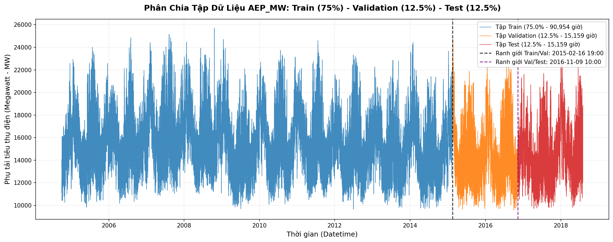

# Phân Tách Đặc Trưng & Phân Chia Train / Validation / Test (Feature Matrix & Time-Based Splitting)

Tài liệu này chi tiết hóa toàn bộ quy trình thực hiện **Bước 3: Chia $X - y$** và **Bước 4: Chia Train / Validation / Test theo thời gian** với tỷ lệ **$75\% - 12.5\% - 12.5\%$** trong notebook [`scripts/main.ipynb`](../scripts/main.ipynb).

---

## 1. Cơ Sở Lý Thuyết & Biểu Diễn Toán Học

### 1.1. Ma trận đặc trưng $X$ và Vector biến mục tiêu $y$ (Bước 3)
Từ bảng dữ liệu học có giám sát `df_supervised` thu được sau Bước 2 ($121.272$ dòng $\times 25$ cột), ta phân tách thành:
1. **Vector mục tiêu ($y \in \mathbb{R}^N$):** Cột phụ tải $y_t$ tại thời điểm hiện tại cần dự đoán.
2. **Ma trận đặc trưng ($X \in \mathbb{R}^{N \times p}$):** Gồm $p = 24$ đặc trưng trễ trong quá khứ:
   $$\mathbf{x}_t = \big[ y_{t-1}, y_{t-2}, \dots, y_{t-24} \big]^T \in \mathbb{R}^{24}$$
3. **Mục tiêu học máy:** Tìm hàm ánh xạ phi tuyến xấp xỉ:
   $$\hat{y}_t = f(\mathbf{x}_t) = f(y_{t-1}, y_{t-2}, \dots, y_{t-24})$$

### 1.2. Nguyên tắc phân chia theo trình tự thời gian (Time-Based Splitting - Bước 4)
Khác với bài toán học máy trên dữ liệu bảng độc lập (tabular i.i.d.), chuỗi thời gian có đặc tính **phụ thuộc thời gian** và **tính nhân quả (Causality)**:
* **Quy tắc vàng (Strict Rule):** **Tuyệt đối KHÔNG shuffle (xáo trộn ngẫu nhiên)**.
* **Nguy cơ rò rỉ dữ liệu (Data Leakage / Look-ahead Bias):** Nếu sử dụng `train_test_split(..., shuffle=True)`, thông tin từ tương lai ($t+k$) sẽ lọt vào tập huấn luyện ($t$), làm mô hình đạt điểm số cao ảo nhưng hoàn toàn tê liệt khi dự báo thực tế.
* **Giải pháp chuẩn:** Cắt lát tuần tự (Slicing) theo dòng thời gian tăng dần.

---

## 2. Chiến Lược Phân Bổ 3 Tập Dữ Liệu (75% - 12.5% - 12.5%)

Việc phân chia thành 3 phần thay vì 2 phần mang lại lợi thế vượt trội cho các mô hình Gradient Boosting (XGBoost):

```text
[======================= TRAIN (75.0%) =======================][== VALIDATION (12.5%) ==][===== TEST (12.5%) =====]
2004-10-02 01:00                                            2015-02-16 18:00          2016-11-09 09:00       2018-08-03 00:00
```

1. **Tập Huấn Luyện (Train - 75%):**
   - Đóng vai trò cung cấp dữ liệu lịch sử để mô hình học các mẫu chu kỳ (ngày, tuần, mùa), xu hướng và cấu trúc phân nhánh của cây quyết định.
2. **Tập Thẩm Định (Validation - 12.5%):**
   - Đóng vai trò là tập giám sát độc lập trong quá trình huấn luyện XGBoost.
   - Cho phép áp dụng cơ chế **Early Stopping** (`early_stopping_rounds`): dừng quá trình thêm cây mới khi hàm mất mát trên tập Validation không còn giảm, triệt tiêu nguy cơ Overfitting.
   - Hỗ trợ tinh chỉnh siêu tham số (Hyperparameter Tuning) trước khi đánh giá cuối cùng.
3. **Tập Kiểm Thử (Test - 12.5%):**
   - Dữ liệu tương lai hoàn toàn chưa từng được nhìn thấy ("unseen hold-out data").
   - Đảm bảo đánh giá khách quan, trung thực năng lực dự báo thực tế của mô hình ở Bước 6.

---

## 3. Kết Quả Định Lượng Thực Nghiệm

Toàn bộ $121.272$ mẫu thời gian được phân chia chính xác tuyệt đối:

| Thuộc tính | Toàn bộ chuỗi ($N$) | Tập Train ($75\%$) | Tập Validation ($12.5\%$) | Tập Test ($12.5\%$) |
|---|---|---|---|---|
| **Số quan sát (giờ)** | **$121.272$** | **$90.954$** | **$15.159$** | **$15.159$** |
| **Tỷ lệ phần trăm** | $100,0\%$ | $75,00\%$ | $12,50\%$ | $12,50\%$ |
| **Kích thước ma trận $X$** | $(121272, 24)$ | $(90954, 24)$ | $(15159, 24)$ | $(15159, 24)$ |
| **Kích thước vector $y$** | $(121272,)$ | $(90954,)$ | $(15159,)$ | $(15159,)$ |
| **Mốc bắt đầu** | `2004-10-02 01:00:00` | `2004-10-02 01:00:00` | `2015-02-16 19:00:00` | `2016-11-09 10:00:00` |
| **Mốc kết thúc** | `2018-08-03 00:00:00` | `2015-02-16 18:00:00` | `2016-11-09 09:00:00` | `2018-08-03 00:00:00` |
| **Thời lượng tương đương** | $\approx 13,84\text{ năm}$ | $\approx 10,38\text{ năm}$ | $\approx 1,73\text{ năm}$ | $\approx 1,73\text{ năm}$ |
| **Phụ tải trung bình (mean)** | $15.498,92\text{ MW}$ | $15.762,54\text{ MW}$ | $14.618,89\text{ MW}$ | $14.801,07\text{ MW}$ |
| **Độ lệch chuẩn (std)** | $2.591,42\text{ MW}$ | $2.574,97\text{ MW}$ | $2.575,58\text{ MW}$ | $2.373,28\text{ MW}$ |

### Kiểm định tính liên tục & bảo toàn dữ liệu:
* **Liên tục giữa Train và Validation:**  
  $$\Delta t = t_{\text{val, start}} - t_{\text{train, end}} = \text{2015-02-16 19:00:00} - \text{2015-02-16 18:00:00} = 1\text{ giờ} \quad (\text{Đạt})$$
* **Liên tục giữa Validation và Test:**  
  $$\Delta t = t_{\text{test, start}} - t_{\text{val, end}} = \text{2016-11-09 10:00:00} - \text{2016-11-09 09:00:00} = 1\text{ giờ} \quad (\text{Đạt})$$
* **Bảo toàn số lượng mẫu:**  
  $$N_{\text{train}} + N_{\text{val}} + N_{\text{test}} = 90.954 + 15.159 + 15.159 = 121.272 = N \quad (\text{Đạt } 100\%)$$

---

## 4. Trực Quan Hóa Phân Bổ Chuỗi Thời Gian

Biểu đồ trực quan hóa 3 tập dữ liệu được tự động tạo và lưu trữ tại [`docs/images/03_train_val_test_split.png`](images/03_train_val_test_split.png):



* **Vùng xanh dương (Train - 75%):** Bao phủ hơn 10 năm phụ tải từ 2004 đến đầu 2015, chứa trọn vẹn các đỉnh phụ tải mùa đông và mùa hè.
* **Vùng cam (Validation - 12.5%):** Kéo dài từ tháng 02/2015 đến tháng 11/2016, đại diện cho giai đoạn chuyển tiếp.
* **Vùng đỏ (Test - 12.5%):** Kéo dài từ tháng 11/2016 đến tháng 08/2018, dùng làm chuẩn thẩm định cuối cùng.

---

## 5. Đúc Kết & Sẵn Sàng Cho Bước 5 (Huấn Luyện XGBoost)

Việc có sẵn tập Validation độc lập tạo điều kiện lý tưởng cho **Bước 5: Huấn luyện mô hình XGBoost Regressor**:
```python
model = XGBRegressor(
    n_estimators=1000,
    learning_rate=0.05,
    max_depth=6,
    random_state=42
)
model.fit(
    X_train, y_train,
    eval_set=[(X_train, y_train), (X_val, y_val)],
    verbose=False
)
```
Mô hình sẽ theo dõi hàm mất mát trên cả `eval_set` để tự động xác định điểm dừng tối ưu, tránh tình trạng Overfitting trên tập Train.

