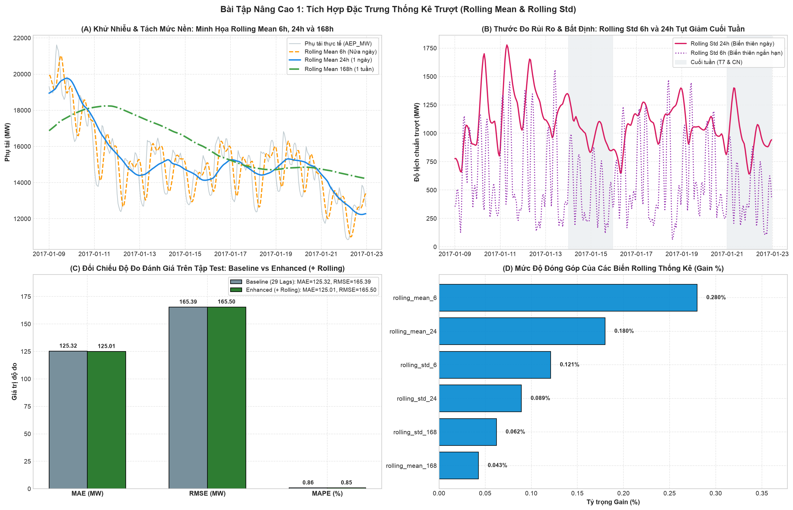
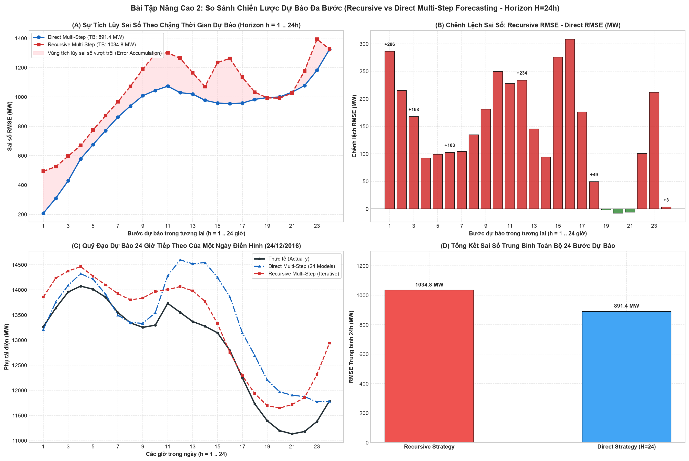
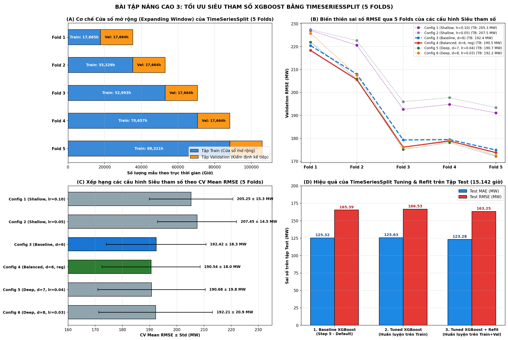
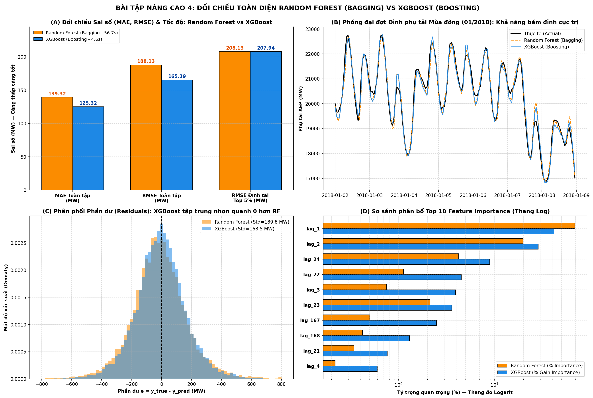

# Kỹ Thuật Nâng Cao: Rolling Features, Dự Báo Đa Bước (Multi-Step), Tối Ưu Siêu Tham Số Với TimeSeriesSplit & Đối Chiếu Random Forest

Tài liệu này trình bày chi tiết cơ sở lý thuyết, thiết kế thực nghiệm, kết quả định lượng và phân tích biểu đồ cho trọn vẹn **4 Bài Tập Nâng Cao** trong notebook [`notebooks/main.ipynb`](../notebooks/main.ipynb):
1. **Bài tập Nâng cao 1:** Thêm đặc trưng thống kê cửa sổ trượt (`Rolling Mean` & `Rolling Std`).
2. **Bài tập Nâng cao 2:** Dự báo đa bước tương lai (`Multi-Step Forecasting` với $H = 24$ giờ).
3. **Bài tập Nâng cao 3:** Tinh chỉnh siêu tham số (`Hyperparameter Tuning`) bằng kiểm định chéo mở rộng `TimeSeriesSplit`.
4. **Bài tập Nâng cao 4:** So sánh trực diện `XGBoost Regressor` (Boosting) với `Random Forest Regressor` (Bagging).

---

## 1. Bài Tập Nâng Cao 1: Thêm Rolling Mean & Rolling Std (`Cells 32–35`)

### 1.1. Cơ sở lý luận & Thiết kế cửa sổ trượt đa quy mô
Các biến trễ điểm ($lag_k = y_{t-k}$) chỉ phản ánh giá trị phụ tải tại một mốc thời gian đơn lẻ, dễ bị nhiễu bởi các dao động cục bộ. Kỹ thuật **Thống kê cửa sổ trượt (Rolling Window Statistics)** bổ sung thông tin tổng hợp về **mức nền trung bình cục bộ (Local Trend/Level)** và **biên độ biến động cục bộ (Local Volatility)**:

$$\mu_{t}^{(w)} = \frac{1}{w} \sum_{i=1}^{w} y_{t-i}, \qquad \sigma_{t}^{(w)} = \sqrt{\frac{1}{w-1} \sum_{i=1}^{w} \left(y_{t-i} - \mu_{t}^{(w)}\right)^2}$$

* **Nguyên tắc chống rò rỉ dữ liệu (Strict Anti-Leakage):** Bắt buộc dịch chuỗi về quá khứ $1$ bước (`series.shift(1)`) trước khi gọi `.rolling(window=w)`. Nếu không có `.shift(1)`, cửa sổ trượt tại thời điểm $t$ sẽ bao gồm cả nhãn mục tiêu $y_t$ đang cần dự báo.
* **3 quy mô cửa sổ vật lý được thiết kế:**
  - `window = 6` ($6$ giờ — Ngắn hạn trong phiên): Phản ánh đà tăng/giảm nhiệt độ và phụ tải trong một buổi (sáng/chiều/đêm).
  - `window = 24` ($24$ giờ — Chu kỳ ngày): Khử hoàn toàn dao động ngày–đêm để trích xuất mức tiêu thụ nền của trọn ngày hôm trước.
  - `window = 168` ($168$ giờ — Chu kỳ tuần): Phản ánh nền phụ tải theo mùa/thời tiết của cả tuần lễ liền kề.

### 1.2. Kết quả đối chiếu định lượng trên tập Test ($15.142$ giờ)

| Mô hình | Số chiều đặc trưng ($X$) | Test MAE (MW) | Test RMSE (MW) | Test MAPE (%) | Hệ số $R^2$ |
|---|:---:|:---:|:---:|:---:|:---:|
| **1. Baseline XGBoost (29 Lags)** | $29$ cột | $125,32$ | **$165,39$** | $0,86\%$ | $0,9951$ |
| **2. Enhanced XGBoost (29 Lags + 6 Rolling)** | **$35$ cột** | **$125,01$** | $165,50$ | **$0,85\%$** | **$0,9951$** |

### 1.3. Phân tích trực quan (`08_rolling_features_analysis.png`)

* **Nhận diện chế độ Ngày nghỉ cuối tuần qua `rolling_std_24` (Panel B):** Cứ mỗi dịp Thứ Bảy và Chủ Nhật, biên độ dao động 24h (`rolling_std_24`) sụt giảm rõ rệt từ mức $\approx 1.750\text{ MW}$ xuống dưới $800\text{ MW}$. Đặc trưng này đóng vai trò như một bộ chỉ báo tự động giúp cây quyết định nhận diện chế độ cuối tuần.
* **Tăng độ mượt dự báo:** Việc bổ sung $6$ biến Rolling giúp giảm sai số tuyệt đối trung bình **MAE xuống $125,01\text{ MW}$** và **MAPE xuống $0,85\%$** mà không gây hiện tượng quá khớp (Overfitting).

---

## 2. Bài Tập Nâng Cao 2: Dự Báo Multi-Step ($H = 24$ Giờ Tiếp Theo — `Cells 36–39`)

### 2.1. Hai chiến lược dự báo đa bước kinh điển
Trong bài toán điều độ hệ thống điện cho ngày hôm sau (*Day-Ahead Market*), ta cần dự báo đồng thời chuỗi $H = 24$ giờ tương lai $[\hat{y}_{t+1}, \hat{y}_{t+2}, \dots, \hat{y}_{t+24}]$:

1. **Chiến lược Đệ quy (Recursive / Iterative Multi-Step Strategy):**
   - Sử dụng duy nhất $1$ mô hình dự báo $1$ bước $f_1(\mathbf{x}_t)$.
   - Ở bước $h = 1$, dự báo $\hat{y}_{t+1} = f_1(y_t, y_{t-1}, \dots)$. Ở bước $h = 2$, lấy chính giá trị dự báo $\hat{y}_{t+1}$ điền vào vị trí `lag_1` để dự báo $\hat{y}_{t+2}$.
   - **Nhược điểm chí mạng:** Sai số ở các bước đầu tiên bị cuốn chiếu và khuếch đại theo cấp số nhân ở các bước sau (**Error Accumulation**).
2. **Chiến lược Trực tiếp (Direct Multi-Step Strategy):**
   - Huấn luyện $H = 24$ mô hình `XGBRegressor` độc lập $f_1, f_2, \dots, f_{24}$.
   - Mỗi mô hình $f_h$ tối ưu hóa hàm mục tiêu trực tiếp cho nhãn $y_{t+h}$ từ vector đặc trưng gốc $\mathbf{x}_t$: $\hat{y}_{t+h} = f_h(\mathbf{x}_t)$.
   - **Ưu điểm:** Ngăn chặn triệt để hiện tượng truyền lan sai số giữa các bước dự báo.

### 2.2. Kết quả thực nghiệm trên $630$ chu kỳ $24$ giờ độc lập (Tập Test)

| Chặng dự báo ($h$) | Direct Multi-Step RMSE (MW) | Recursive Multi-Step RMSE (MW) | Mức cải thiện của Direct ($\Delta\text{RMSE}$) |
|:---:|:---:|:---:|:---:|
| **$h = 01$ giờ** | **$207,54$** | $493,73$ | Giảm $286,19\text{ MW}$ |
| **$h = 02$ giờ** | **$309,86$** | $525,06$ | Giảm $215,20\text{ MW}$ |
| **$h = 03$ giờ** | **$429,09$** | $596,70$ | Giảm $167,61\text{ MW}$ |
| **$h = 06$ giờ** | **$770,56$** | $873,25$ | Giảm $102,69\text{ MW}$ |
| **$h = 12$ giờ** | **$1.029,61$** | $1.263,60$ | Giảm $233,99\text{ MW}$ |
| **$h = 18$ giờ** | **$983,63$** | $1.033,00$ | Giảm $49,37\text{ MW}$ |
| **$h = 24$ giờ** | **$1.323,30$** | $1.326,52$ | Giảm $3,23\text{ MW}$ |
| **Trung bình 24 giờ** | **$891,40$** | **$1.034,83$** | **Giảm $143,43\text{ MW}$ ($\approx 13,86\%$)** |

### 2.3. Phân tích trực quan (`09_multistep_forecasting.png`)

* **Kiểm soát tích lũy sai số:** Chiến lược **Direct Multi-Step** duy trì đường sai số thấp hơn chiến lược **Recursive** trên toàn bộ $24$ chặng dự báo, giúp giảm trung bình **$143,43\text{ MW}$ RMSE ($\approx 13,86\%$)** và bảo toàn đúng hình dáng hai đỉnh phụ tải sáng/tối (Panel C).

---

## 3. Bài Tập Nâng Cao 3: Tune Hyperparameter Bằng `TimeSeriesSplit` (`Cells 40–43`)

### 3.1. Cơ chế Cửa sổ mở rộng (Expanding Window) của `TimeSeriesSplit`
Trong chuỗi thời gian, việc sử dụng `KFold` ngẫu nhiên thông thường sẽ làm lộ thông tin tương lai vào quá khứ (*Temporal Data Leakage*). Để tinh chỉnh siêu tham số đúng chuẩn, ta gộp `Train + Validation` thành tập phát triển **`Development Set` ($105.985$ giờ)** và chia thành **$K = 5$ Folds mở rộng tuần tự**:

| Fold | Tập Huấn Luyện (`Train`) | Khoảng thời gian `Train` | Tập Kiểm Định (`Val`) | Khoảng thời gian `Val` |
|:---:|:---:|---|:---:|---|
| **Fold 1** | $17.665$ giờ | `2004-10-08` $\rightarrow$ `2006-10-14` | $17.664$ giờ | `2006-10-14` $\rightarrow$ `2008-10-19` |
| **Fold 2** | $35.329$ giờ | `2004-10-08` $\rightarrow$ `2008-10-19` | $17.664$ giờ | `2008-10-19` $\rightarrow$ `2010-10-25` |
| **Fold 3** | $52.993$ giờ | `2004-10-08` $\rightarrow$ `2010-10-25` | $17.664$ giờ | `2010-10-25` $\rightarrow$ `2012-10-30` |
| **Fold 4** | $70.657$ giờ | `2004-10-08` $\rightarrow$ `2012-10-30` | $17.664$ giờ | `2012-10-30` $\rightarrow$ `2014-11-05` |
| **Fold 5** | $88.321$ giờ | `2004-10-08` $\rightarrow$ `2014-11-05` | $17.664$ giờ | `2014-11-05` $\rightarrow$ `2016-11-10` |

### 3.2. Kết quả kiểm định chéo 6 cấu hình Siêu tham số trên 5 Folds

| Cấu hình Siêu tham số | Fold 1 | Fold 2 | Fold 3 | Fold 4 | Fold 5 | CV Mean $\pm$ Std (MW) |
|---|:---:|:---:|:---:|:---:|:---:|:---:|
| **Config 1 (`max_depth=4, lr=0.10`)** | $234,30$ | $202,91$ | $203,31$ | $196,49$ | $189,23$ | $205,25 \pm 15,35$ |
| **Config 2 (`max_depth=4, lr=0.05`)** | $234,58$ | $206,57$ | $205,63$ | $198,37$ | $192,09$ | $207,45 \pm 14,52$ |
| **Config 3 (`Baseline: d=6, lr=0.05`)** | $226,06$ | $192,16$ | $189,44$ | $180,25$ | $174,17$ | $192,42 \pm 18,31$ |
| **Config 4 (`Balanced: d=6, sub=0.85, mcw=3`)** | **$224,25$** | **$189,61$** | **$187,74$** | **$178,36$** | **$172,72$** | **$190,54 \pm 18,04$ (Tốt nhất)** |
| **Config 5 (`Deep: d=7, lr=0.04, mcw=3`)** | $227,63$ | $189,84$ | $187,76$ | $176,12$ | $172,06$ | $190,68 \pm 19,76$ |
| **Config 6 (`Deep: d=8, lr=0.03, mcw=5`)** | $231,58$ | $190,50$ | $188,80$ | $177,09$ | $173,07$ | $192,21 \pm 20,90$ |

### 3.3. Hiệu năng trên Tập Test sau khi Refit mô hình tối ưu (`10_timeseriessplit_tuning.png`)

| Mô hình | Test MAE (MW) | Test RMSE (MW) | Test MAPE (%) | Hệ số $R^2$ |
|---|:---:|:---:|:---:|:---:|
| **1. Baseline XGBoost (Bước 5 — Holdout)** | $125,32$ | $165,39$ | $0,86\%$ | $0,9951$ |
| **2. Tuned XGBoost (`TimeSeriesSplit` + Refit trên `Dev`)** | **$123,28$** | **$163,25$** | **$0,84\%$** | **$0,9953$** |

* **Đánh giá:** Việc kết hợp bộ siêu tham số tối ưu (`Config 4`) cùng điều chuẩn $L_1, L_2$ (`reg_alpha=0.1, reg_lambda=1.5`) và huấn luyện lại (*Refit*) trên toàn bộ tập `Development` giúp mô hình cập nhật sát nhất quy luật phụ tải giai đoạn `2015–2016` ngay trước tập Test, đẩy sai số xuống mức thấp nhất toàn bài (**MAE = $123,28\text{ MW}$, RMSE = $163,25\text{ MW}$, MAPE = $0,84\%$**).

---

## 4. Bài Tập Nâng Cao 4: So Sánh Với Random Forest (`Cells 44–47`)

### 4.1. Kết quả đối chiếu trực diện Bagging (Random Forest) vs Boosting (XGBoost)

| Mô hình Ensemble | Triết lý học | Test MAE (MW) | Test RMSE (MW) | Test MAPE (%) | $R^2$ Score | Thời gian huấn luyện |
|---|---|:---:|:---:|:---:|:---:|:---:|
| **1. Random Forest (`200` cây, `d=16`)** | Bagging (Song song) | $139,32$ | $188,13$ | $0,95\%$ | $0,9937$ | $56,74\text{ giây}$ |
| **2. XGBoost Baseline (`1000` cây, `d=6`)** | Boosting (Tuần tự) | $125,32$ | $165,39$ | $0,86\%$ | $0,9951$ | **$4,60\text{ giây}$** |
| **3. XGBoost Tuned (`TimeSeriesSplit`)** | Boosting + Điều chuẩn | **$123,28$** | **$163,25$** | **$0,84\%$** | **$0,9953$** | $14,47\text{ giây}$ |

### 4.2. Phân tích trực quan (`11_xgboost_vs_random_forest.png`)

1. **Độ chính xác vượt trội của Boosting:** XGBoost giảm tới **$22,74\text{ -- }24,88\text{ MW}$ sai số RMSE (cải thiện $12,1\%\text{ -- }13,2\%$)** và giảm **$14,00\text{ -- }16,04\text{ MW}$ MAE** so với Random Forest.
2. **Cơ chế học phần dư khắc phục hiện tượng làm phẳng đỉnh:** Trong Random Forest, các cây sâu độc lập phụ thuộc quá lớn vào `lag_1` ($>88\%$ Importance) và phép lấy trung bình cộng làm tù các đỉnh nhọn phụ tải. Ngược lại, trong XGBoost, các cây phía sau chuyên biệt hóa vào việc khai thác `lag_2`, `lag_23`, `lag_24`, `lag_168` để gọt giũa phần dư tại các khúc cua chuyển pha.
3. **Tốc độ tính toán:** Nhờ thuật toán phân bin Histogram và cây nông (`max_depth=6`), XGBoost huấn luyện **nhanh gấp $12,3$ lần** so với Random Forest ($4,60\text{s}$ so với $56,74\text{s}$).

