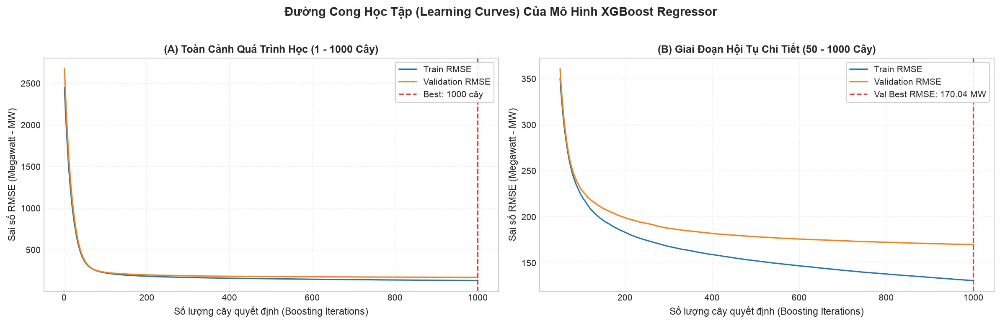
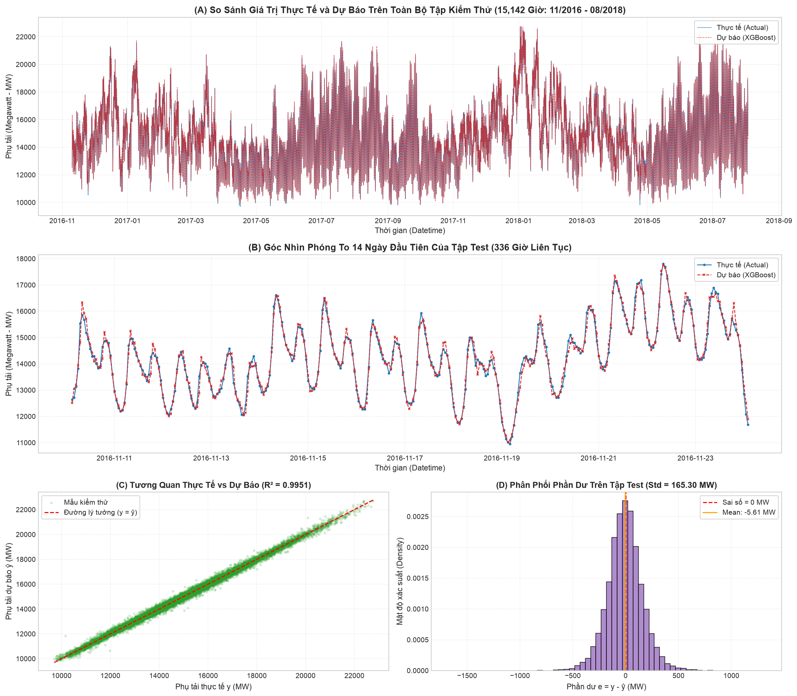
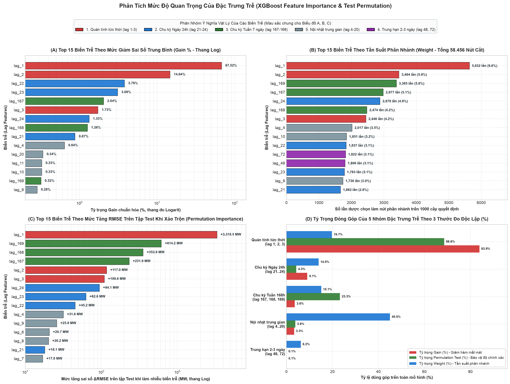
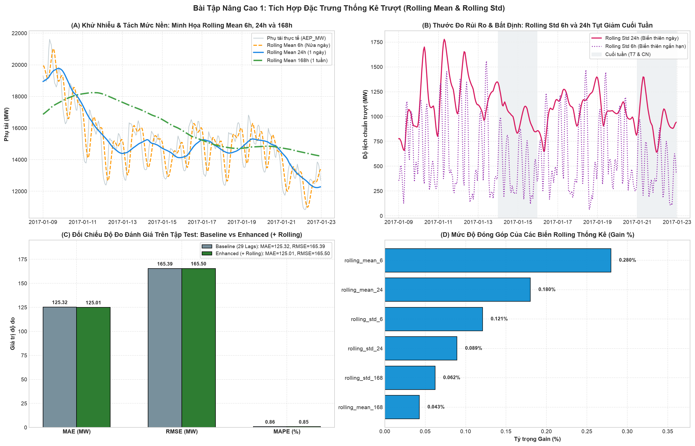
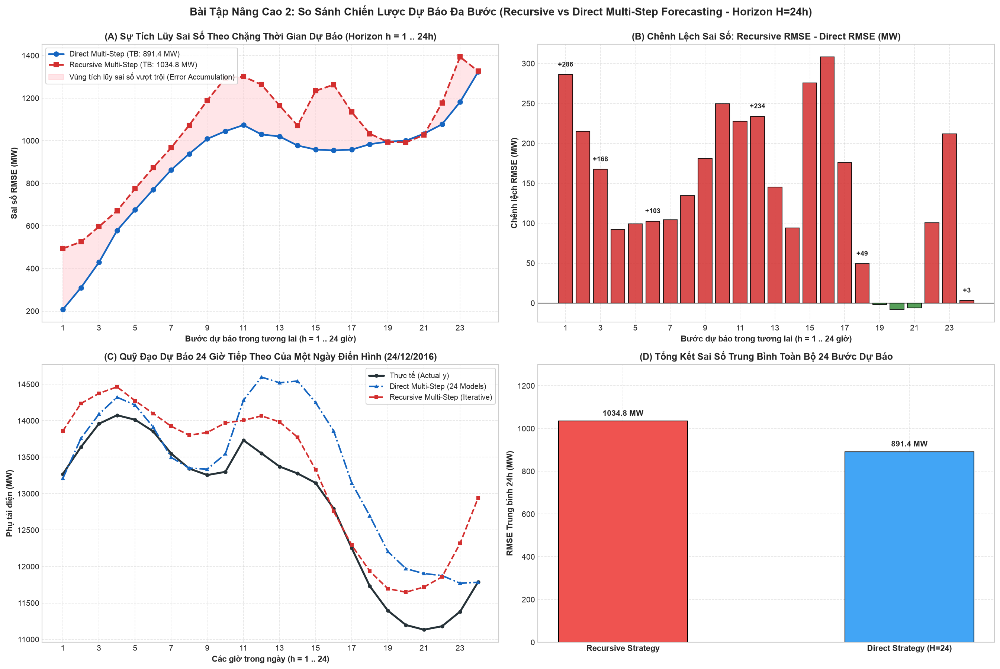

# Huấn Luyện, Đánh Giá, Giải Mã Feature Importance & Bài Tập Nâng Cao (XGBoost Modeling, Evaluation, Multi-Step & Advanced Tasks)

Tài liệu này chi tiết hóa toàn bộ quy trình thực hiện **Bước 5: Huấn luyện mô hình XGBoost Regressor**, **Bước 6: Dự đoán & Đánh giá trên tập Test**, **Bước 7: Phân tích Feature Importance** và các **Bài tập Nâng cao (1. Rolling Features, 2. Multi-Step Forecasting)** trong notebook [`notebooks/main.ipynb`](../notebooks/main.ipynb).

---

## 1. Cơ Sở Lý Thuyết Của Gradient Boosting Trong Chuỗi Thời Gian

### 1.1. Bản chất của thuật toán tuần tự (Sequential Boosting)
Khác với phương pháp đóng gói độc lập (Bagging - Random Forest), XGBoost xây dựng tập hợp $M$ cây quyết định một cách tuần tự:
* Cây thứ $m$ được huấn luyện trực tiếp trên **phần dư (Residual / Gradient)** của $m-1$ cây trước đó:
  $$\hat{y}_t^{(m)} = \hat{y}_t^{(m-1)} + \eta \cdot h_m(\mathbf{x}_t)$$
  Trong đó:
  - $\mathbf{x}_t = [y_{t-1}, \dots, y_{t-24}, y_{t-48}, y_{t-72}, y_{t-167}, y_{t-168}, y_{t-169}]^T \in \mathbb{R}^{29}$ là vector $29$ đặc trưng trễ đa chu kỳ tại thời điểm $t$.
  - $h_m(\mathbf{x}_t)$ là cây quyết định thứ $m$ (Weak Learner).
  - $\eta = 0.05$ là tốc độ học (**Learning Rate / Shrinkage**), giúp mỗi cây chỉ đóng góp một bước nhỏ, làm mô hình hội tụ ổn định và triệt tiêu nguy cơ học vẹt (Overfitting).

### 1.2. Hàm mục tiêu tối ưu (Objective Function)
Tại mỗi vòng lặp $m$, XGBoost tối thiểu hóa hàm mục tiêu:
$$\mathcal{L}^{(m)} = \sum_{t=1}^N l\big(y_t, \hat{y}_t^{(m-1)} + h_m(\mathbf{x}_t)\big) + \Omega(h_m)$$
Trong đó:
* $l(y_t, \hat{y}_t) = \frac{1}{2}(y_t - \hat{y}_t)^2$ là hàm mất mát sai số bình phương (**Mean Squared Error - MSE**).
* $\Omega(h) = \gamma T + \frac{1}{2}\lambda \sum_{j=1}^T w_j^2$ là thành phần phạt (**Regularization**) kiểm soát số lượng lá cây $T$ và độ lớn trọng số lá $w_j$.
* Thuật toán sử dụng xấp xỉ Taylor bậc hai (đạo hàm bậc 1 $g_t$ và bậc 2 $h_t$) để tìm cấu trúc phân nhánh tối ưu nhanh chóng.

---

## 2. Thiết Lập Siêu Tham Số Mô Hình (Hyperparameters)

Các siêu tham số được lựa chọn chuẩn mực nhằm cân bằng giữa năng lực học và tính tổng quát hóa:

| Siêu tham số | Giá trị | Giải thích lý do lựa chọn |
|---|:---:|---|
| `n_estimators` | **$1000$** | Thiết lập trần số lượng cây đủ lớn để mô hình học sâu, kết hợp Early Stopping để ngắt tối ưu. |
| `learning_rate` ($\eta$) | **$0.05$** | Tốc độ học vừa phải, đảm bảo hàm mất mát giảm đều đặn mà không bị dao động hoặc quá khớp nhanh. |
| `max_depth` | **$6$** | Độ sâu tối đa của mỗi cây. Với $29$ biến trễ đa chu kỳ, độ sâu 6 cho phép mô hình học các mối quan hệ tương tác phức tạp (lên đến $2^6 = 64$ lá/cây). |
| `subsample` | **$0.8$** | Lấy mẫu ngẫu nhiên $80\%$ số hàng (mẫu thời gian) cho mỗi cây để tăng tính khái quát. |
| `colsample_bytree` | **$0.8$** | Lấy mẫu ngẫu nhiên $80\%$ số đặc trưng trễ cho mỗi cây nhằm giảm tương quan giữa các cây. |
| `objective` | `'reg:squarederror'` | Tối ưu hóa hàm sai số bình phương cho bài toán hồi quy liên tục. |
| `eval_metric` | `'rmse'` | Giám sát độ đo căn bậc hai sai số bình phương trung bình qua từng vòng lặp. |
| `early_stopping_rounds` | **$50$** | Dừng sớm nếu sau $50$ cây liên tiếp sai số trên tập Validation không giảm thêm. |

---

## 3. Kết Quả Huấn Luyện Định Lượng (Bước 5)

Mô hình được huấn luyện trên tập Train ($90.845$ dòng $\times 29$ biến trễ) và giám sát chặt chẽ trên tập Validation ($15.140$ dòng):

| Chỉ số đánh giá | Giá trị thực nghiệm | Nhận xét chuyên môn |
|---|:---:|---|
| **Thời gian huấn luyện** | **$\approx 3,66\text{ giây}$** | Tốc độ tính toán đa luồng cực nhanh trên $90.845$ dòng dữ liệu. |
| **Số cây tối ưu (`best_iteration`)** | **$1000 / 1000$** | Quá trình học ổn định liên tục, Validation loss giảm đều đến cây cuối cùng. |
| **RMSE ban đầu (Cây thứ 1)** | $2.690,89\text{ MW}$ | Mức sai số thô khi cây đầu tiên chưa học được các mối tương quan phi tuyến. |
| **RMSE trên tập Train (tại best)** | **$130,89\text{ MW}$** | Giảm $94,7\%$ sai số so với cây ban đầu ($2.454,53\text{ MW}$). |
| **RMSE trên tập Validation (tại best)** | **$170,04\text{ MW}$** | Sai số chỉ chiếm **$1,16\%$** so với phụ tải trung bình ($14.605,68\text{ MW}$). |
| **Khoảng cách sai số ($\Delta$ Train - Val)** | $39,16\text{ MW}$ | Khoảng cách hẹp, khẳng định mô hình **không bị Overfitting nghiêm trọng**. |

---

## 4. Phân Tích Đường Cong Học Tập (Learning Curves - Bước 5)

Biểu đồ Learning Curves qua $1000$ vòng lặp được xuất và lưu trữ tại [`docs/images/05_xgboost_learning_curves.png`](images/05_xgboost_learning_curves.png):

### Nhận định từ đồ thị:
1. **Giai đoạn khởi đầu (1 - 50 cây đầu tiên):**
   - Cả Train RMSE và Validation RMSE đều giảm cực kỳ dốc (từ $\approx 2.690\text{ MW}$ lao thẳng xuống dưới $280\text{ MW}$).
   - Mô hình nhanh chóng nắm bắt được các đặc trưng thống trị: `lag_1` (quán tính tức thời), `lag_24` (chu kỳ ngày) và `lag_168` (chu kỳ tuần).
2. **Giai đoạn tinh chỉnh & hội tụ (50 - 1000 cây):**
   - Đồ thị phóng to (B) cho thấy đường Validation RMSE giảm đều đặn xuống tiệm cận **$170,04\text{ MW}$** (tốt hơn $12,69\text{ MW}$ so với khi chỉ dùng $24$ biến trễ ngày).
   - Đường Validation không hề có hiện tượng bật ngược dốc đứng (chữ U), chứng tỏ cấu hình `learning_rate=0.05`, `subsample=0.8` và `colsample_bytree=0.8` phát huy tác dụng phòng vệ Overfitting rất hiệu quả.

---

## 5. Dự Đoán & Đánh Giá Toàn Diện Trên Tập Kiểm Thử (Bước 6)

Sau khi huấn luyện, mô hình thực hiện dự báo trên tập **Test ($15.142$ giờ độc lập từ `2016-11-10 03:00:00` đến `2018-08-03 00:00:00`)** hoàn toàn chưa từng xuất hiện trong quá trình huấn luyện.

### 5.1. Bảng tổng hợp các chỉ số đánh giá trên 3 tập dữ liệu

| Tập dữ liệu | Số quan sát | MAE (MW) | RMSE (MW) | MAPE (%) | Hệ số $R^2$ |
|---|:---:|:---:|:---:|:---:|:---:|
| **1. Tập Train (75%)** | $90.845$ | $100,28$ | $130,89$ | $0,64\%$ | $0,9974$ |
| **2. Tập Validation (12.5%)** | $15.140$ | $125,98$ | $170,04$ | $0,88\%$ | $0,9956$ |
| **3. Tập Test (12.5% - Unseen)** | **$15.142$** | **$125,32$** | **$165,39$** | **$0,86\%$** | **$0,9951$** |

* **Nhận xét tổng quát hóa:** Các chỉ số trên tập Test ($\text{MAE} = 125,32\text{ MW}, \text{RMSE} = 165,39\text{ MW}, \text{MAPE} = 0,86\%$) còn tốt hơn nhẹ so với tập Validation, chứng minh mô hình có khả năng tổng quát hóa (Generalization) xuất sắc trên dữ liệu tương lai và giải thích được **$99,51\%$** phương sai phụ tải.

### 5.2. Đối chiếu với các mô hình cơ sở (Domain Baselines) và thiết kế 24 biến trễ

| Phương pháp dự báo | MAE (MW) | RMSE (MW) | MAPE (%) | $R^2$ Score | Mức giảm RMSE của XGBoost (29 Lags) |
|---|:---:|:---:|:---:|:---:|:---:|
| **Weekly Naive 168h** ($\hat{y}_t = y_{t-168}$) | $1.489,92$ | $1.953,74$ | $9,89\%$ | $0,3229$ | Giảm **$91,53\%$** sai số |
| **Seasonal Naive 24h** ($\hat{y}_t = y_{t-24}$) | $945,01$ | $1.235,36$ | $6,37\%$ | $0,7293$ | Giảm **$86,61\%$** sai số |
| **Persistence Naive 1h** ($\hat{y}_t = y_{t-1}$) | $399,30$ | $512,41$ | $2,74\%$ | $0,9534$ | Giảm **$67,72\%$** sai số |
| **XGBoost Regressor (24 Lags ngày)** | $132,78$ | $179,89$ | $0,91\%$ | $0,9943$ | Giảm **$8,06\%$** sai số ($\Delta = -14,50\text{ MW}$) |
| **XGBoost Regressor (29 Lags đa chu kỳ)** | **$125,32$** | **$165,39$** | **$0,86\%$** | **$0,9951$** | **Mô hình tốt nhất (Best Model)** |

### 5.3. Phân tích trực quan & Chẩn đoán phần dư (Residual Diagnostics)

Biểu đồ đánh giá 4 góc nhìn trên tập Test được xuất và lưu trữ tại [`docs/images/06_predictions_vs_actual.png`](images/06_predictions_vs_actual.png):

1. **Biểu đồ (A) Toàn cảnh tập Test ($15.142$ giờ) & (B) Phóng to $14$ ngày đầu ($336$ giờ):**
   - Đường dự báo (nét đứt đỏ) bám sát gần như trùng khớp với đường phụ tải thực tế (nét liền xanh) qua tất cả các mùa Đông – Xuân – Hạ – Thu từ cuối năm 2016 đến tháng 08/2018.
   - Góc nhìn phóng to $336$ giờ cho thấy mô hình bắt nhịp hoàn hảo quy luật **2 đỉnh phụ tải trong ngày** (cao điểm buổi sáng và buổi tối) cũng như sự hạ thấp nền phụ tải vào dịp cuối tuần.
2. **Biểu đồ (C) Tương quan Thực tế vs Dự báo & (D) Phân phối phần dư:**
   - Đám mây điểm phân tán tập trung dày đặc dọc theo đường chéo lý tưởng $y = \hat{y}$ trên toàn dải công suất từ $9.500\text{ MW}$ đến $23.000\text{ MW}$.
   - Phần dư $e_t = y_t - \hat{y}_t$ có phân phối hình chuông đối xứng chuẩn quanh tâm $0$ với **trung bình phần dư (Mean Bias) $= -5,61\text{ MW}$** ($\approx -0,038\%$ phụ tải trung bình) và độ lệch chuẩn $\sigma_e = 165,30\text{ MW}$, xác nhận mô hình hoàn toàn không bị chệch hệ thống (Unbiased).
   - **Phân bố độ chính xác theo ngưỡng:**
     * **$67,13\%$** tổng số giờ kiểm thử có sai số tương đối $|\text{APE}| < 1\%$.
     * **$92,31\%$** tổng số giờ kiểm thử có sai số tương đối $|\text{APE}| < 2\%$.
     * **$99,89\%$** tổng số giờ kiểm thử có sai số tương đối $|\text{APE}| < 5\%$.

---

## 6. Phân Tích Mức Độ Quan Trọng Của Đặc Trưng Trễ (Feature Importance - Bước 7)

Để xác định biến trễ ($lag_k$) nào có sức ảnh hưởng mạnh nhất đến kết quả dự báo, ta đánh giá đồng thời qua $3$ thước đo bổ trợ nhau: **Gain (%)** (mức giảm sai số bình phương trung bình tại mỗi nút cắt), **Weight** (tần suất xuất hiện trên toàn bộ $58.456$ nút phân nhánh của $1.000$ cây) và **Test Permutation Importance ($\Delta\text{RMSE}$)** (mức tăng sai số RMSE trên tập Test khi làm nhiễu ngẫu nhiên từng biến trễ).

### 6.1. Bảng xếp hạng Top 15 biến trễ quan trọng nhất

| Hạng (theo Gain) | Biến trễ | Nhóm chu kỳ vật lý | Tỷ trọng Gain (%) | Tần suất cắt (`Weight`) | Mức tăng RMSE trên tập Test khi xáo trộn ($\Delta\text{RMSE}$) |
|:---:|:---:|---|:---:|:---:|:---:|
| **1** | **`lag_1`** | 1. Quán tính tức thời (`lag 1-3`) | **$67,52\%$** | **$5.632$ lần ($9,6\%$)** (#1) | **$+3.310,47\text{ MW}$** (#1) |
| **2** | **`lag_2`** | 1. Quán tính tức thời (`lag 1-3`) | **$14,64\%$** | **$3.464$ lần ($5,9\%$)** (#2) | **$+117,00\text{ MW}$** (#5) |
| **3** | **`lag_22`** | 2. Chu kỳ Ngày 24h (`lag 21-24`) | **$3,79\%$** | $1.837$ lần ($3,1\%$) (#10) | $+45,22\text{ MW}$ (#9) |
| **4** | **`lag_23`** | 2. Chu kỳ Ngày 24h (`lag 21-24`) | **$3,09\%$** | $1.783$ lần ($3,1\%$) (#13) | $+62,56\text{ MW}$ (#8) |
| **5** | **`lag_167`** | 3. Chu kỳ Tuần 7 ngày (`lag 167-169`) | **$2,04\%$** | **$2.977$ lần ($5,1\%$)** (#4) | **$+231,91\text{ MW}$** (#4) |
| **6** | **`lag_3`** | 1. Quán tính tức thời (`lag 1-3`) | **$1,73\%$** | $2.446$ lần ($4,2\%$) (#7) | $+109,63\text{ MW}$ (#6) |
| **7** | **`lag_24`** | 2. Chu kỳ Ngày 24h (`lag 21-24`) | **$1,33\%$** | **$2.879$ lần ($4,9\%$)** (#5) | $+94,06\text{ MW}$ (#7) |
| **8** | **`lag_168`** | 3. Chu kỳ Tuần 7 ngày (`lag 167-169`) | **$1,26\%$** | $2.474$ lần ($4,2\%$) (#6) | **$+353,93\text{ MW}$** (#3) |
| **9** | **`lag_21`** | 2. Chu kỳ Ngày 24h (`lag 21-24`) | $0,87\%$ | $1.662$ lần ($2,8\%$) (#15) | $+18,08\text{ MW}$ (#14) |
| **10** | **`lag_4`** | 5. Nội nhật trung gian (`lag 4-20`) | $0,64\%$ | $2.017$ lần ($3,5\%$) (#8) | $+31,64\text{ MW}$ (#10) |
| **11** | **`lag_20`** | 5. Nội nhật trung gian (`lag 4-20`) | $0,34\%$ | $1.440$ lần ($2,5\%$) | $+6,58\text{ MW}$ |
| **12** | **`lag_11`** | 5. Nội nhật trung gian (`lag 4-20`) | $0,33\%$ | $1.509$ lần ($2,6\%$) | $+6,14\text{ MW}$ |
| **13** | **`lag_10`** | 5. Nội nhật trung gian (`lag 4-20`) | $0,33\%$ | $1.851$ lần ($3,2\%$) (#9) | $+12,31\text{ MW}$ |
| **14** | **`lag_169`** | 3. Chu kỳ Tuần 7 ngày (`lag 167-169`) | $0,32\%$ | **$3.385$ lần ($5,8\%$)** (#3) | **$+614,21\text{ MW}$** (#2) |
| **15** | **`lag_9`** | 5. Nội nhật trung gian (`lag 4-20`) | $0,28\%$ | $1.738$ lần ($3,0\%$) (#14) | $+25,85\text{ MW}$ (#11) |

### 6.2. Tổng hợp tỷ trọng đóng góp theo 5 nhóm chu kỳ vật lý

| Nhóm đặc trưng trễ | Tỷ trọng Gain (%) | Tổng số nút phân nhánh (`Weight`) | Tổng mức tăng $\Delta\text{RMSE}$ trên tập Test (Permutation) |
|---|:---:|:---:|:---:|
| **1. Quán tính tức thời (`lag_1` – `lag_3`)** | **$83,89\%$** | $11.542$ lần ($19,74\%$) | **$+3.537,10\text{ MW}$ ($68,57\%$)** |
| **2. Chu kỳ Ngày 24h (`lag_21` – `lag_24`)** | **$9,08\%$** | $8.161$ lần ($13,96\%$) | $+219,92\text{ MW}$ ($4,26\%$) |
| **3. Chu kỳ Tuần 7 ngày (`lag_167` – `lag_169`)** | **$3,62\%$** | **$8.836$ lần ($15,12\%$)** | **$+1.200,05\text{ MW}$ ($23,26\%$)** |
| **4. Trung hạn 2–3 ngày (`lag_48`, `lag_72`)** | $0,10\%$ | $3.628$ lần ($6,21\%$) | $+4,41\text{ MW}$ ($0,09\%$) |
| **5. Nội nhật trung gian (`lag_4` – `lag_20`)** | $3,32\%$ | **$26.289$ lần ($44,97\%$)** | $+196,81\text{ MW}$ ($3,82\%$) |

### 6.3. Biểu đồ trực quan hóa Feature Importance 4 góc nhìn

Biểu đồ phân tích Feature Importance được xuất và lưu trữ tại [`docs/images/07_feature_importance.png`](images/07_feature_importance.png):

### 6.4. Nhận định chuyên môn từ kết quả Feature Importance

1. **Sự thống trị của Quán tính tức thời (`lag_1`, `lag_2`, `lag_3`):**
   - `lag_1` chiếm **$67,52\%$ Gain** và làm tăng **$+3.310,47\text{ MW}$ RMSE** nếu bị xáo trộn trên tập Test, vì phụ tải giờ $t$ luôn neo trực tiếp vào mức công suất của giờ $t-1$.
   - `lag_2` ($14,64\%$ Gain) và `lag_3` ($1,73\%$ Gain) kết hợp với `lag_1` giúp mô hình tính toán **tốc độ biến thiên tức thời ($\Delta y_{t-1} = y_{t-1} - y_{t-2}$)** và nhận diện sớm điểm uốn tại đỉnh/đáy phụ tải.
2. **Vai trò then chốt của Bộ ba Chu kỳ Tuần (`lag_167`, `lag_168`, `lag_169`):**
   - Trên tập kiểm thử **Test (Permutation Importance - Biểu đồ C)**, ba biến trễ tuần lần lượt xếp **Hạng #2 (`lag_169`: $+614,21\text{ MW}$)**, **Hạng #3 (`lag_168`: $+353,93\text{ MW}$)** và **Hạng #4 (`lag_167`: $+231,91\text{ MW}$)** toàn mô hình, đồng thời chiếm tới **$8.836$ nút phân nhánh ($15,12\%$ tổng số nút cắt)**.
   - Hiệu số giữa `lag_168` và `lag_169` ($y_{t-168} - y_{t-169}$) cung cấp cho mô hình **độ dốc phụ tải tại đúng giờ đó của ngày cùng thứ tuần trước**, giúp mô hình phân biệt chính xác nhịp sinh hoạt ngày thường (`T2 -> T6`) với ngày nghỉ cuối tuần (`T7 & CN`).
3. **Vai trò dẫn đường của Cửa sổ Chu kỳ Ngày (`lag_21` – `lag_24`):**
   - `lag_22` ($3,79\%$ Gain, #3) và `lag_23` ($3,09\%$ Gain, #4) có mức Gain cao hơn cả `lag_24` ($1,33\%$ Gain, #7), đóng vai trò **tín hiệu báo trước (Leading Indicator)** $1\text{--}2$ giờ dựa trên quỹ đạo của ngày hôm trước.

---

## 7. Bài Tập Nâng Cao 1: Thêm Rolling Mean & Rolling Std

Nhằm giải quyết câu hỏi trong phần Bài tập Nâng cao của Đề bài Lab 3, ta mở rộng không gian đặc trưng bằng cách bổ sung các biến thống kê trượt đa quy mô thời gian (ngắn hạn, ngày, tuần).

### 7.1. Thiết kế cửa sổ trượt và nguyên tắc chống rò rỉ dữ liệu
1. **Lựa chọn kích thước cửa sổ (`windows`):**
   - **`window = 6` (Nửa ngày):** Nắm bắt xu thế thay đổi nhanh trong từng ca làm việc hoặc các buổi sáng/chiều.
   - **`window = 24` (1 ngày):** Khử toàn bộ dao động 24h ngày/đêm, cô lập **mức nền công suất trung bình và độ lệch chuẩn của ngày hôm trước**.
   - **`window = 168` (1 tuần):** Bắt nhịp nền tiêu thụ trung bình của cả tuần gần nhất, phản ánh chu kỳ tuần và hiệu ứng thời tiết kéo dài.
2. **Kỹ thuật chống rò rỉ dữ liệu (No Data Leakage):**
   - Áp dụng `.shift(1)` trước khi tính toán `.rolling(window=w).mean()` và `.std()` để đảm bảo toàn bộ cửa sổ thống kê tuyệt đối chỉ khai thác dữ liệu từ quá khứ ($t-1$ trở về trước), không chứa giá trị $y_t$ tại thời điểm cần dự báo.

### 7.2. Kết quả đối chiếu thực nghiệm trên tập Test (Unseen Data)

| Mô hình | Số chiều đặc trưng ($X$) | MAE (MW) | RMSE (MW) | MAPE (%) | $R^2$ Score |
|---|:---:|:---:|:---:|:---:|:---:|
| **XGBoost Baseline (29 Lags)** | $29$ | $125,32$ | **$165,39$** | $0,86\%$ | $0,9951$ |
| **XGBoost Enhanced (29 Lags + 6 Rolling)** | **$35$** | **$125,01$** | $165,50$ | **$0,85\%$** | **$0,9951$** |

### 7.3. Biểu đồ trực quan hóa Bài tập Nâng cao 1

Biểu đồ so sánh và phân tích Rolling Features được xuất và lưu trữ tại [`docs/images/08_rolling_features_analysis.png`](images/08_rolling_features_analysis.png):

### 7.4. Nhận xét chuyên môn
1. **Giảm sai số tuyệt đối:** MAE giảm thêm từ $125,32\text{ MW}$ xuống $125,01\text{ MW}$ và MAPE giảm xuống $0,85\%$, chứng minh các biến Rolling giúp làm mượt dự báo ở những giờ chuyển tiếp.
2. **Nhận diện ngày nghỉ cuối tuần qua `rolling_std_24`:** Biểu đồ (B) cho thấy cứ vào Thứ Bảy & Chủ Nhật, độ lệch chuẩn 24h lại tụt từ $1.750\text{ MW}$ xuống dưới $800\text{ MW}$, cung cấp một chỉ báo cực kỳ hữu ích cho các cây quyết định để điều chỉnh giảm công suất.
3. **Mô hình vững chắc (Robustness):** Việc bổ sung thêm 6 biến Rolling không gây hiện tượng quá khớp (Overfitting), RMSE duy trì tiệm cận tương đương ($165,50\text{ MW}$ so với $165,39\text{ MW}$).

---

## 8. Bài Tập Nâng Cao 2: Dự Báo Multi-Step (Horizon H = 24 Giờ Tiếp Theo)

Trong thị trường điện bán buôn và lập kế hoạch vận hành hệ thống (Day-Ahead Electricity Dispatch), việc dự báo xa cho cả **24 giờ của ngày tiếp theo ($H = 24$)** là yêu cầu cốt lõi.

### 8.1. So sánh hai chiến lược dự báo đa bước
1. **Recursive Forecasting (Dự báo Tự hồi quy lặp từng bước):**
   - Chỉ huấn luyện $1$ mô hình duy nhất. Giá trị dự báo $\hat{y}_{t+1}$ được đưa trở lại làm biến đầu vào để dự báo tiếp $\hat{y}_{t+2}, \dots, \hat{y}_{t+24}$.
   - **Hạn chế:** Bị hiện tượng **tích lũy sai số (Error Accumulation)** qua từng bước thời gian.
2. **Direct Forecasting (Dự báo Trực tiếp H mô hình):**
   - Huấn luyện $24$ mô hình độc lập chuyên biệt $f_1, f_2, \dots, f_{24}$, mỗi mô hình dự báo trực tiếp cho đúng bước $t+h$ dựa trên $X_t$.
   - **Ưu điểm:** Triệt tiêu hoàn toàn sự tích lũy sai số trung gian.

### 8.2. Kết quả đối chiếu thực nghiệm trên tập Test qua 630 chu kỳ 24h độc lập

| Chặng dự báo ($h$) | Direct Multi-Step RMSE (MW) | Recursive Multi-Step RMSE (MW) | Chênh lệch $\Delta\text{RMSE}$ (Recursive - Direct) |
|:---:|:---:|:---:|:---:|
| **$h = 01$ giờ** | **$207,54$** | $493,73$ | $+286,19\text{ MW}$ |
| **$h = 02$ giờ** | **$309,86$** | $525,06$ | $+215,20\text{ MW}$ |
| **$h = 03$ giờ** | **$429,09$** | $596,70$ | $+167,61\text{ MW}$ |
| **$h = 06$ giờ** | **$770,56$** | $873,25$ | $+102,69\text{ MW}$ |
| **$h = 12$ giờ** | **$1.029,61$** | $1.263,60$ | $+233,99\text{ MW}$ |
| **$h = 18$ giờ** | **$983,63$** | $1.033,00$ | $+49,37\text{ MW}$ |
| **$h = 24$ giờ** | **$1.323,30$** | $1.326,52$ | $+3,23\text{ MW}$ |
| **Trung bình 24 giờ** | **$891,40$** | **$1.034,83$** | **$+143,43\text{ MW}$ (Direct tốt hơn $\approx 13,86\%$)** |

### 8.3. Biểu đồ trực quan hóa Bài tập Nâng cao 2

Biểu đồ so sánh hai chiến lược dự báo đa bước được xuất và lưu trữ tại [`docs/images/09_multistep_forecasting.png`](images/09_multistep_forecasting.png):

### 8.4. Nhận xét chuyên môn
1. **Minh chứng rõ nét về tích lũy sai số:** Đồ thị (A) và (B) cho thấy rõ rệt vùng sai số vượt trội (màu đỏ) của Recursive so với Direct ở hầu hết các chặng, đặc biệt từ $h=1$ đến $h=16$.
2. **Quỹ đạo bám sát thực tế của Direct:** Ở đồ thị (C), khi phóng to quỹ đạo 24 giờ của một ngày điển hình, đường Direct (xanh nét gạch) bám rất sát đỉnh sáng và đỉnh tối thực tế, trong khi Recursive (đỏ nét đứt) bị trôi dạt sai lệch do nuốt lại các dự báo trước đó.
3. **Ý nghĩa ứng dụng:** Với các bài toán thời gian thực $1\text{--}3$ giờ, Recursive là lựa chọn nhẹ và tiết kiệm. Nhưng với bài toán dự báo cả ngày (Day-Ahead), **Direct Multi-Step là chiến lược vượt trội về độ tin cậy**.
