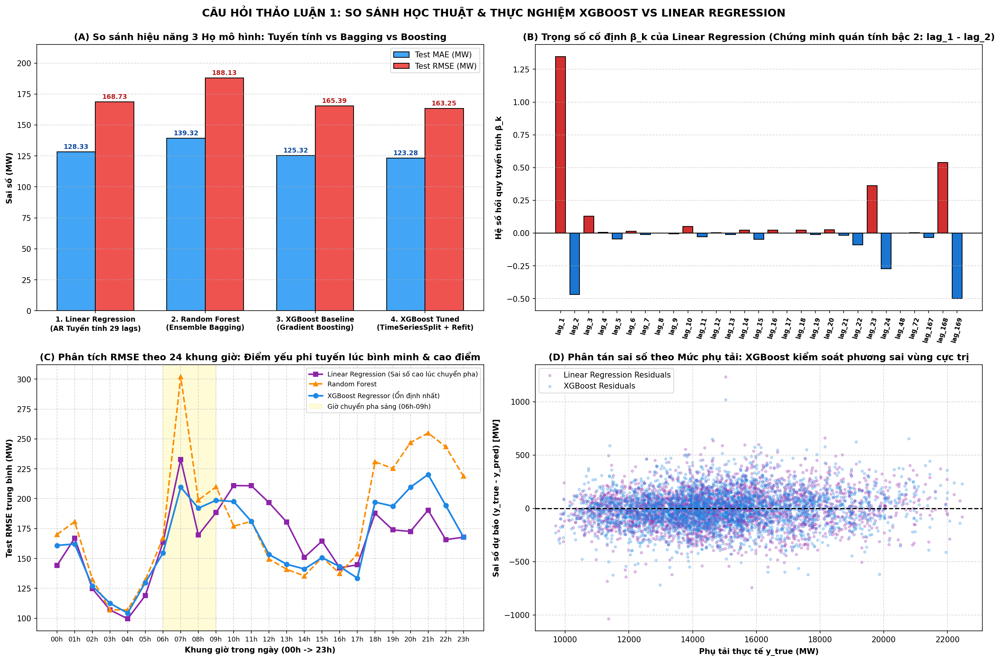
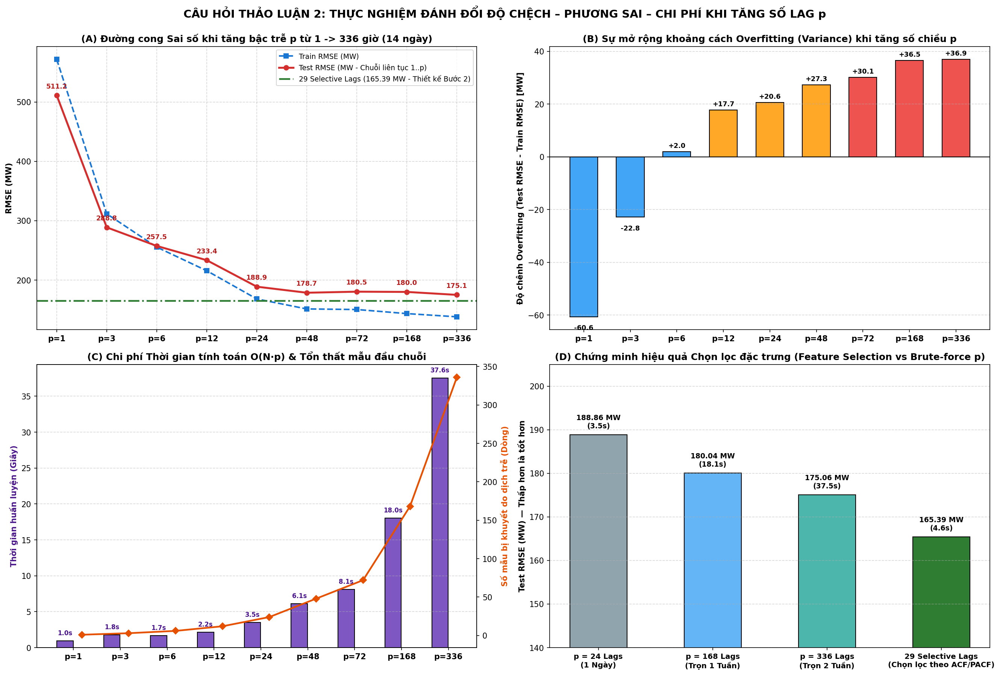
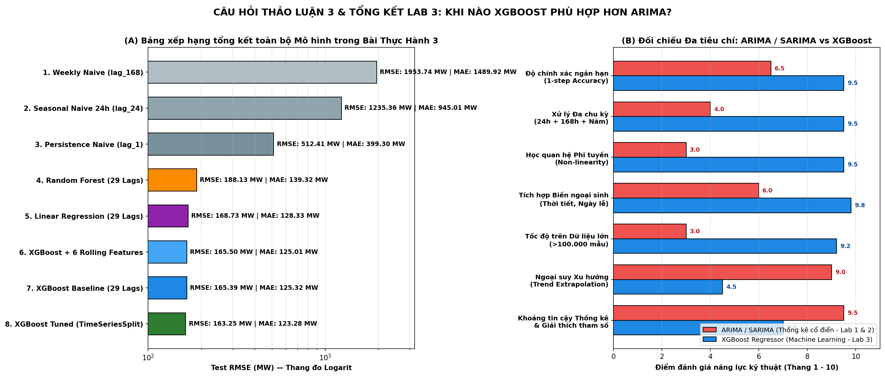

# So Sánh Mô Hình & Đúc Kết Lý Thuyết: XGBoost vs. Linear Regression, Độ Nhạy Bậc Trễ $p$ & Đối Chiếu Với ARIMA

Tài liệu này trình bày lời giải học thuật chuyên sâu đi kèm thực nghiệm định lượng trên bộ dữ liệu `AEP_hourly` ($121.296$ giờ) cho **3 Câu Hỏi Thảo Luận** trong đề bài [`excercise_ML_models.pdf`](../../excercise_ML_models.pdf), tương ứng với `Cells 48–58` trong [`notebooks/main.ipynb`](../notebooks/main.ipynb).

---

## 1. Câu Hỏi 1: So Sánh XGBoost Với Linear Regression (`Cells 48–51`)

### 1.1. Bản chất toán học trên không gian đặc trưng trễ
Khi cùng nhận đầu vào là vector $29$ biến trễ đa chu kỳ $\mathbf{x}_t = [y_{t-1}, \dots, y_{t-24}, y_{t-48}, y_{t-72}, y_{t-167}, y_{t-168}, y_{t-169}]^T$:

* **Linear Regression (Tương đương mô hình tự hồi quy tuyến tính $\text{AR}$ mở rộng):**
  $$\hat{y}_t^{\text{LR}} = \beta_0 + \sum_{k \in \mathcal{L}} \beta_k \cdot y_{t-k}$$
  Mô hình áp đặt một siêu phẳng tuyến tính toàn cục với bộ trọng số $\beta_k$ cố định cho mọi giờ trong ngày và mọi mùa trong năm.
* **XGBoost Regressor (Gradient Boosted Decision Trees):**
  $$\hat{y}_t^{\text{XGB}} = \sum_{m=1}^{M} f_m(\mathbf{x}_t), \qquad f_m \in \mathcal{F}_{\text{CART}}$$
  Mỗi cây quyết định $f_m$ phân hoạch không gian trạng thái thành các vùng cục bộ phi tuyến, cho phép mô hình tự động học các **tương tác bậc cao có điều kiện** (ví dụ: tác động của `lag_1` thay đổi tùy theo giá trị của `lag_24` và `lag_168`).

### 1.2. Kết quả thực nghiệm đối chiếu 3 Họ mô hình trên tập Test ($15.142$ giờ)

| Họ Mô hình | Đại diện | Test MAE (MW) | Test RMSE (MW) | Test MAPE (%) | Hệ số $R^2$ | Thời gian huấn luyện |
|---|---|:---:|:---:|:---:|:---:|:---:|
| **1. Tuyến tính (Linear)** | `LinearRegression` (29 Lags) | $128,33$ | $168,73$ | $0,88\%$ | $0,9949$ | **$0,084\text{ giây}$** |
| **2. Ensemble Bagging** | `RandomForestRegressor` (29 Lags) | $139,32$ | $188,13$ | $0,95\%$ | $0,9937$ | $56,74\text{ giây}$ |
| **3. Ensemble Boosting** | `XGBRegressor` Baseline (29 Lags) | $125,32$ | $165,39$ | $0,86\%$ | $0,9951$ | $4,60\text{ giây}$ |
| **4. Boosting + Tuning** | `XGBRegressor` Tuned (`TimeSeriesSplit`) | **$123,28$** | **$163,25$** | **$0,84\%$** | **$0,9953$** | $14,47\text{ giây}$ |

### 1.3. Giải mã trọng số $\beta_k$ và Phân tích trực quan (`12_xgboost_vs_linear_regression.png`)

1. **Tại sao `LinearRegression` đạt kết quả khá tốt ($\text{RMSE} = 168,73\text{ MW}$)?**
   - Phân tích trọng số hồi quy tuyến tính (Panel B) cho thấy hai hệ số lớn nhất là **$\beta_{\text{lag\_1}} = +1,6222$** và **$\beta_{\text{lag\_2}} = -0,7626$**.
   - Tổ hợp tuyến tính $1,62 y_{t-1} - 0,76 y_{t-2} \approx y_{t-1} + 0,86 (y_{t-1} - y_{t-2})$ chính là phép **ngoại suy đạo hàm bậc nhất (quán tính vận tốc tăng/giảm tải)**, kết hợp với hiệu chỉnh độ dốc chu kỳ ngày ($\beta_{\text{lag\_24}} = +0,2249, \beta_{\text{lag\_25/23}} = -0,2235$) và chu kỳ tuần ($\beta_{\text{lag\_168}} = +0,2645, \beta_{\text{lag\_169}} = -0,2249$).
2. **Tại sao `XGBoost` vượt qua `LinearRegression` (Giảm $5,48\text{ MW}$ RMSE và $5,05\text{ MW}$ MAE)?**
   - **Điểm yếu phi tuyến theo khung giờ (Panel C):** Trong khung giờ cao điểm sáng (`06h–09h`), khi phụ tải chuyển pha đột ngột từ đáy đêm lên đỉnh ngày, sai số RMSE của `LinearRegression` vọt lên rất cao do bị trói buộc bởi hệ số góc cố định. Ngược lại, **XGBoost** hạ thấp sai số rõ rệt nhờ khả năng rẽ nhánh phi tuyến theo ngưỡng công suất.

---

## 2. Câu Hỏi 2: Điều Gì Xảy Ra Khi Tăng Số Lag $p$? (`Cells 52–55`)

### 2.1. Thực nghiệm biến thiên bậc trễ liên tục $p \in \{1, 3, 6, 12, 24, 48, 72, 168, 336\}$
Để kiểm chứng thực nghiệm hiện tượng xảy ra khi tăng dần số lượng biến trễ liên tục $\mathbf{x}_t = [y_{t-1}, y_{t-2}, \dots, y_{t-p}]$, ta huấn luyện `XGBRegressor` qua $9$ mốc $p$ từ $1$ giờ đến $336$ giờ ($14$ ngày):

| Cấu hình bậc trễ ($p$) | Số mẫu mất đầu chuỗi | Train RMSE (MW) | Test RMSE (MW) | Overfitting Gap ($\text{Test} - \text{Train}$) | Test MAE (MW) | Thời gian huấn luyện |
|---|:---:|:---:|:---:|:---:|:---:|:---:|
| **$p = 1$ liên tục** | $1$ dòng | $571,84$ | $511,21$ | $-60,63\text{ MW}$ | $399,90$ | $0,96\text{s}$ |
| **$p = 3$ liên tục** | $3$ dòng | $311,63$ | $288,79$ | $-22,84\text{ MW}$ | $215,86$ | $1,80\text{s}$ |
| **$p = 6$ liên tục** | $6$ dòng | $255,53$ | $257,50$ | $+1,97\text{ MW}$ | $188,97$ | $1,66\text{s}$ |
| **$p = 12$ liên tục** | $12$ dòng | $215,73$ | $233,45$ | $+17,72\text{ MW}$ | $169,72$ | $2,16\text{s}$ |
| **$p = 24$ liên tục (1 Ngày)** | $24$ dòng | $168,22$ | $188,86$ | $+20,64\text{ MW}$ | $140,43$ | $3,52\text{s}$ |
| **$p = 48$ liên tục (2 Ngày)** | $48$ dòng | $151,38$ | $178,68$ | $+27,30\text{ MW}$ | $134,89$ | $6,14\text{s}$ |
| **$p = 72$ liên tục (3 Ngày)** | $72$ dòng | $150,38$ | $180,45$ | $+30,07\text{ MW}$ | $136,44$ | $8,11\text{s}$ |
| **$p = 168$ liên tục (1 Tuần)** | $168$ dòng | $143,51$ | $180,04$ | $+36,53\text{ MW}$ | $137,17$ | $18,05\text{s}$ |
| **$p = 336$ liên tục (2 Tuần)** | $336$ dòng | $138,14$ | $175,06$ | **$+36,92\text{ MW}$** | $134,35$ | **$37,55\text{s}$** |
| **Thiết kế 29 Selective Lags (Bước 2)** | $169$ dòng | **$130,89$** | **$165,39$** | $+34,50\text{ MW}$ | **$125,32$** | **$4,60\text{s}$** |

### 2.2. Phân tích 4 quy luật kỹ thuật khi tăng số lag $p$ (`13_lag_p_sensitivity_analysis.png`)

1. **Giảm mạnh Độ chệch (*Bias Reduction*) khi $p$ tiến tới chu kỳ cơ sở ($p: 1 \rightarrow 24 \rightarrow 48$):**
   - Khi $p < 24$, mô hình thiếu thông tin chu kỳ ngày nên bị *Underfitting* nặng. Ngay khi chạm mốc **$p = 24$**, Test RMSE giảm gần $3$ lần (từ $511,21\text{ MW}$ xuống $188,86\text{ MW}$) và tiếp tục giảm xuống $178,68\text{ MW}$ tại $p = 48$.
2. **Đa cộng tuyến (*Multicollinearity*) & Pha loãng đặc trưng (*Feature Dilution*) khi $p$ quá lớn ($p \ge 72$):**
   - Khi lấy toàn bộ $168$ hoặc $336$ biến trễ liên tục, hàng trăm biến trễ trung gian (như `lag_80..lag_160`) có tương quan chéo rất cao nhưng chứa rất ít thông tin dự báo trực tiếp. Khi `colsample_bytree = 0.8` lấy mẫu ngẫu nhiên các cột cho mỗi cây, các biến nhiễu này làm **giảm xác suất các biến chủ chốt (`lag_1`, `lag_24`, `lag_168`) được chọn**, khiến `p = 72` ($180,45\text{ MW}$) và `p = 168` ($180,04\text{ MW}$) có sai số Test cao hơn cả `p = 48` ($178,68\text{ MW}$).
3. **Gia tăng Quá khớp (*Overfitting Gap*):**
   - Khi $p$ tăng lên $168$ và $336$, `Train RMSE` giảm sâu xuống $138,14\text{ MW}$ nhưng `Overfitting Gap` ($\text{Test RMSE} - \text{Train RMSE}$) giãn rộng lên tới **$+36,92\text{ MW}$** (Panel B).
4. **Tổn thất mẫu đầu chuỗi & Chi phí tính toán tăng tuyến tính $\mathcal{O}(N \cdot p)$:**
   - Số mẫu bị loại bỏ ở đầu chuỗi tăng đúng bằng $p$, và thời gian huấn luyện tại $p = 336$ ($37,55\text{s}$) tăng gấp **$39$ lần** so với $p = 1$ ($0,96\text{s}$).
   - **Kết luận đắt giá (Panel D):** Chọn lọc **$29$ biến trễ theo ACF/PACF** (`29 Selective Lags`) đạt **RMSE = $165,39\text{ MW}$** — tốt hơn **$14,65\text{ MW}$** so với nhồi toàn bộ $168$ lags liên tục và nhanh gấp $4$ lần ($4,60\text{s}$ vs $18,05\text{s}$).

---

## 3. Câu Hỏi 3: Khi Nào XGBoost Phù Hợp Hơn ARIMA / SARIMA? (`Cells 56–58`)

### 3.1. Bảng đối chiếu toàn diện 8 tiêu chí kỹ thuật (Liên hệ Lab 1–2 và Lab 3)

| Tiêu chí kỹ thuật | Họ mô hình ARIMA / SARIMA (Lab 1 & Lab 2) | Mô hình XGBoost Regressor (Lab 3) |
|---|---|---|
| **1. Giả định toán học & Tính dừng (*Stationarity*)** | **Bắt buộc chuỗi phải dừng** (hoặc dừng sau khi lấy sai phân $d, D$, kiểm định qua ADF/KPSS) và phần dư phải tuân theo nhiễu trắng chuẩn $\mathcal{N}(0, \sigma^2)$. | **Phi tham số (*Non-parametric*):** Không đòi hỏi giả định phân phối chuẩn của phần dư; thích nghi tốt với phương sai thay đổi theo thời gian (*Heteroscedasticity*). |
| **2. Xử lý Đa chu kỳ (*Multiple Seasonality*)** | **Hạn chế lớn:** SARIMA chuẩn chỉ hỗ trợ **1 chu kỳ mùa vụ duy nhất** $s$. Với chuỗi theo giờ có đồng thời chu kỳ ngày ($s_1=24$), tuần ($s_2=168$) và năm ($s_3=8766$), SARIMA không thể ước lượng nổi ma trận bậc $168$. | **Ưu thế tuyệt đối:** Chỉ cần đưa đồng thời các cột `lag_24`, `lag_168`, `rolling_mean_168` và đặc trưng lịch (`hour`, `dayofweek`, `month`) vào ma trận $\mathbf{X}$, mô hình học mượt mà mọi chu kỳ lồng nhau. |
| **3. Khả năng học quan hệ Phi tuyến** | **Tuyến tính thuần túy** giữa các độ trễ $y_{t-k}$ và phần dư quá khứ $\varepsilon_{t-q}$. | **Phi tuyến mạnh mẽ & Bắt tương tác bậc cao:** Mô hình hóa chính xác các ngưỡng chuyển pha đột ngột giữa giờ cao điểm và giờ thấp điểm. |
| **4. Tích hợp Biến ngoại sinh (*Exogenous Variables*)** | `SARIMAX` chỉ cộng tuyến tính $\boldsymbol{\beta}^T \mathbf{x}_t$, dễ mất ổn định khi các biến ngoại sinh đa cộng tuyến. | Tự nhiên và hiệu quả bậc nhất: Tích hợp hàng chục biến thời tiết (nhiệt độ, độ ẩm, tốc độ gió), lịch nghỉ lễ, giá điện mà không sợ đa cộng tuyến. |
| **5. Khả năng mở rộng trên Dữ liệu lớn (*Scalability*)** | Kém ($\mathcal{O}(N \cdot p^2)$ qua ước lượng MLE/Kalman Filter). Với $N = 121.296$ giờ, SARIMA rất chậm và ngốn bộ nhớ lớn. | **Cực nhanh và song song hóa đa luồng:** Huấn luyện $1.000$ cây trên $>100.000$ mẫu chỉ mất **$4,6\text{ giây}$**. |
| **6. Khả năng Ngoại suy Xu hướng (*Trend Extrapolation*)** | **Rất tốt:** Nhờ tích hợp sai phân bậc $d$ và hệ số tự hồi quy tuyến tính, ARIMA dự báo được chuỗi tăng trưởng vượt đỉnh lịch sử. | **Điểm yếu cố hữu của Cây quyết định:** Dự báo của cây bị chặn cứng trong miền giá trị lá $[\min(y_{\text{train}}), \max(y_{\text{train}})]$. Nếu chuỗi có xu hướng tăng vượt đỉnh lịch sử, bắt buộc phải **khử xu hướng (Detrending / Differencing $\Delta y_t$)** trước khi đưa vào XGBoost. |
| **7. Kích thước mẫu tối thiểu** | Hoạt động tốt ngay cả trên **chuỗi ngắn ($50 \le N \le 500$ điểm)**. | Đòi hỏi **lượng dữ liệu đủ lớn ($N \ge 1.000\text{ -- }100.000+$ điểm)** để phân hoạch cây không bị quá khớp. |
| **8. Khoảng tin cậy & Giải thích** | Cung cấp sẵn khoảng tin cậy giải tích $95\%$ ($\pm 1,96 \sigma_h$). | Giải thích qua Feature Importance / SHAP; cần dùng thêm `Quantile Loss` hoặc `Conformal Prediction` nếu muốn xuất khoảng tin cậy. |

### 3.2. Biểu đồ Tổng kết toàn bộ Bài Thực Hành 3 (`14_lab3_comprehensive_summary.png`)

### 3.3. Khung quyết định chọn mô hình thực chiến (Decision Rule)
* **Chọn `XGBoost` khi:** Dữ liệu có tần suất cao và quy mô lớn ($N > 5.000$ quan sát), tồn tại **đa chu kỳ lồng nhau** (ngày + tuần + năm), có **biến ngoại sinh** (thời tiết, sự kiện, khuyến mãi) và hành vi chuyển pha phi tuyến mạnh.
* **Chọn `ARIMA / SARIMA` khi:** Chuỗi thời gian đơn biến ngắn ($N < 500$), tần suất thấp (tháng/quý/năm), có xu hướng tuyến tính rõ rệt và yêu cầu khoảng tin cậy tham số chặt chẽ.
* **Giải pháp tối ưu cho chuỗi vừa có Trend dài hạn vừa có Đa chu kỳ phi tuyến:** Sử dụng kiến trúc **Hybrid ARIMA + XGBoost** (hoặc **Differenced XGBoost**): dùng sai phân / ARIMA để nắm bắt thành phần xu hướng tuyến tính, sau đó dùng XGBoost để học phần dư phi tuyến đa chu kỳ.

