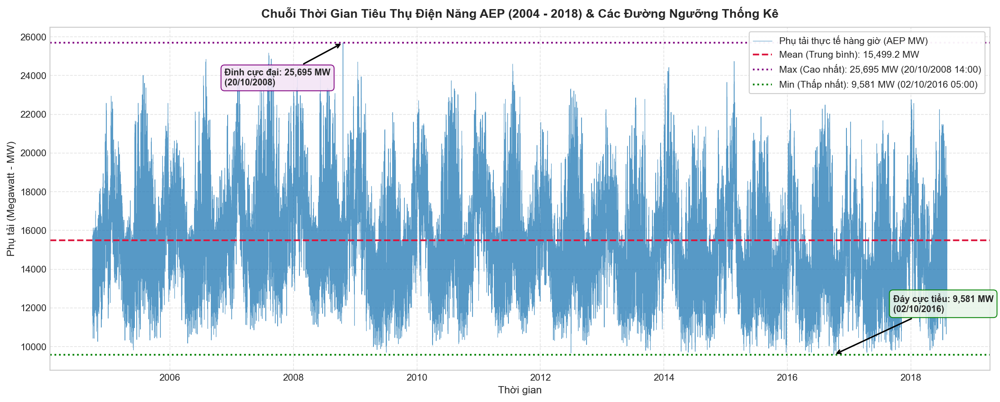
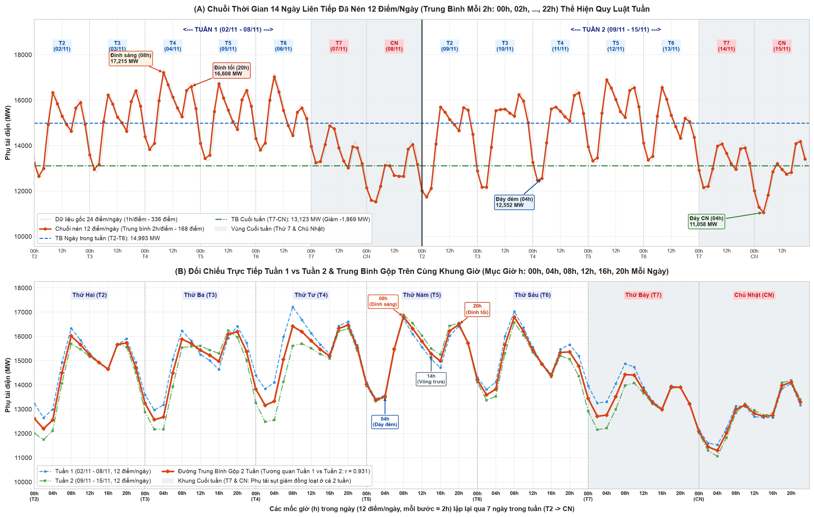
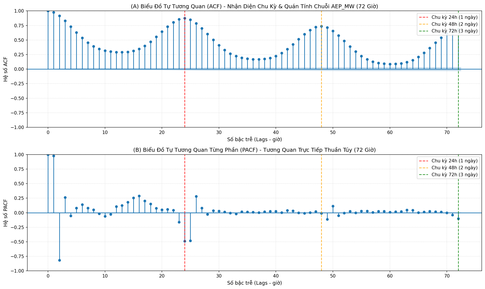
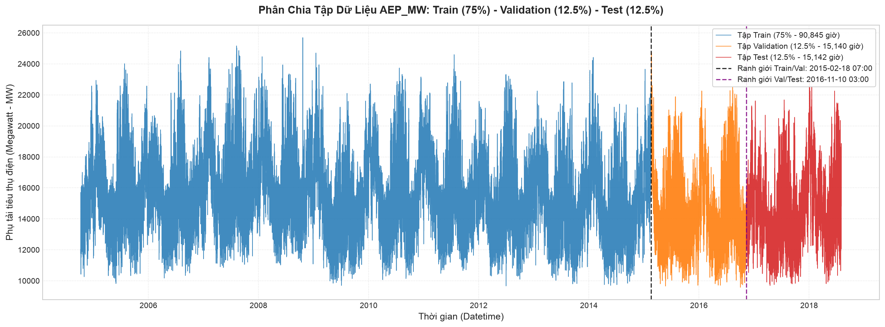
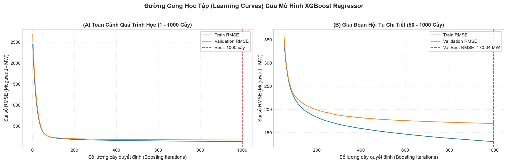
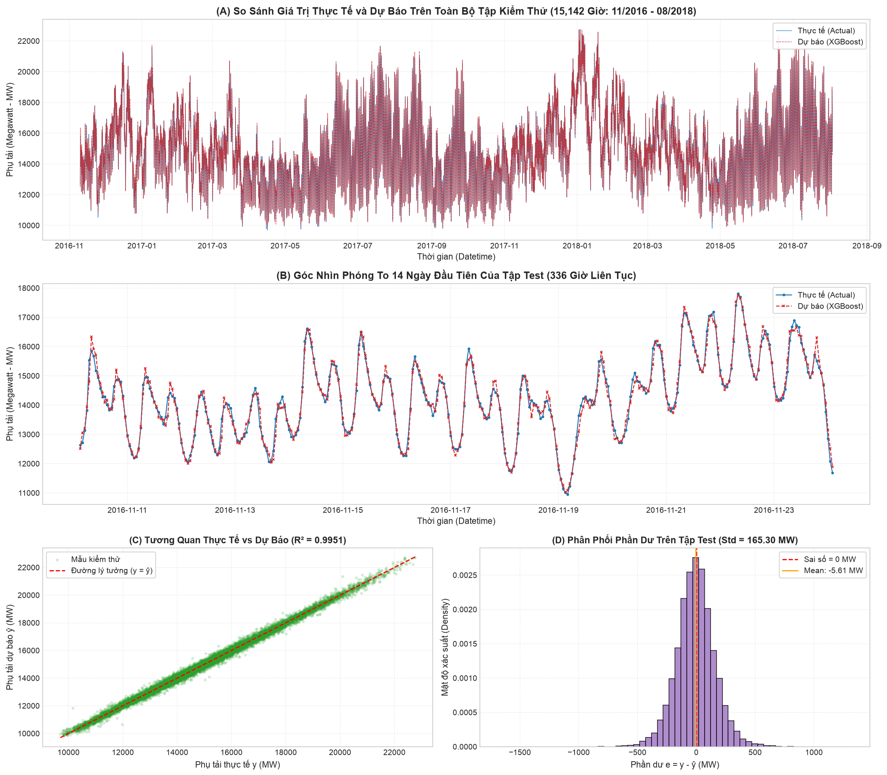
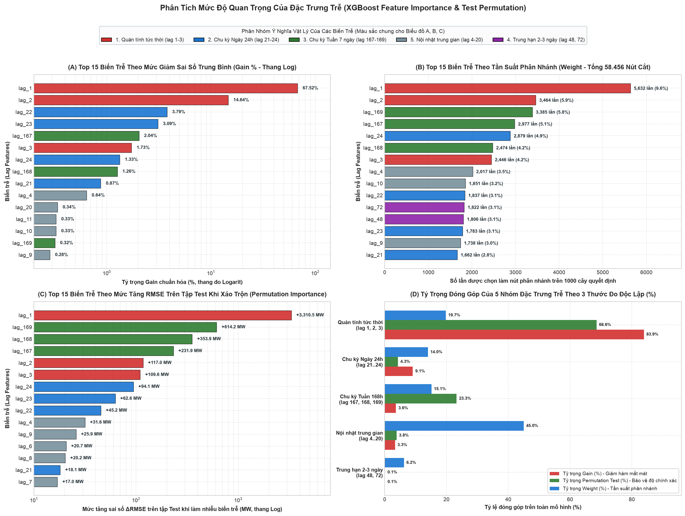
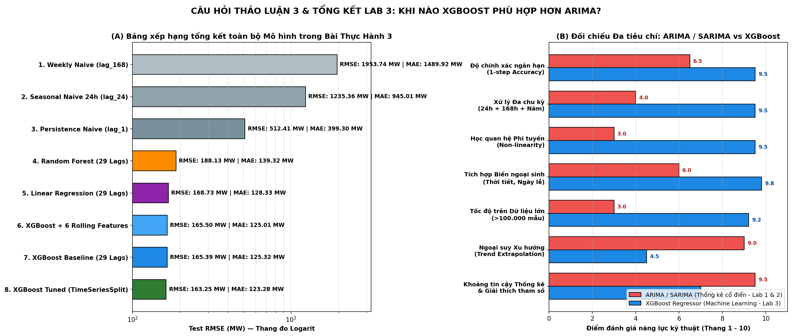

# BÁO CÁO TỔNG HỢP BÀI THỰC HÀNH 3: DỰ ĐOÁN CHUỖI THỜI GIAN SỬ DỤNG MACHINE LEARNING MODELS

**Bộ dữ liệu:** PJM Hourly Energy Consumption (`AEP_hourly.csv` — $121.296$ giờ liên tục, `2004–2018`)  
**Notebook thực thi:** [`notebooks/main.ipynb`](../notebooks/main.ipynb) | **Đề bài:** [`excercise_ML_models.pdf`](../../excercise_ML_models.pdf)

---

## Mục Lục
1. [Tóm Tắt Điều Hành (Executive Summary)](#1-tóm-tắt-điều-hành-executive-summary)
2. [Phần 1: Quy Trình 7 Bước Thực Hành Cơ Bản](#2-phần-1-quy-trình-7-bước-thực-hành-cơ-bản)
3. [Phần 2: Kết Quả 4 Bài Tập Nâng Cao](#3-phần-2-kết-quả-4-bài-tập-nâng-cao)
4. [Phần 3: Giải Đáp & Thực Nghiệm 3 Câu Hỏi Thảo Luận](#4-phần-3-giải-đáp--thực-nghiệm-3-câu-hỏi-thảo-luận)
5. [Bảng Xếp Hạng Tổng Kết Toàn Bộ Các Mô Hình](#5-bảng-xếp-hạng-tổng-kết-toàn-bộ-các-mô-hình)

---

## 1. Tóm Tắt Điều Hành (Executive Summary)

Báo cáo này tổng hợp toàn bộ kết quả nghiên cứu và thực nghiệm của **Bài tập thực hành 3: Dự đoán chuỗi thời gian sử dụng Machine Learning models** trên bộ dữ liệu phụ tải điện hàng giờ của hệ thống **American Electric Power (`AEP_hourly.csv`)** kéo dài gần $14$ năm (`2004-10-01 01:00:00` đến `2018-08-03 00:00:00`).

* **Chuyển đổi bài toán:** Biến đổi chuỗi đơn biến $y_t$ ($121.296$ giờ) thành bài toán học có giám sát (**Supervised Learning**) dựa trên phân tích tự tương quan **ACF & PACF**, thiết kế **$29$ biến trễ đa chu kỳ** (`lag_1..24`, `lag_48`, `lag_72`, `lag_167..169`) giúp bảo toàn đồng thời quán tính ngắn hạn, chu kỳ ngày ($24\text{h}$) và chu kỳ tuần ($168\text{h}$).
* **Thành tựu định lượng nổi bật trên tập Kiểm thử độc lập (`Test Set` — $15.142$ giờ):**
  - **Mô hình `XGBoost Baseline` (29 Lags):** Đạt **$\text{MAE} = 125,32\text{ MW}$**, **$\text{RMSE} = 165,39\text{ MW}$**, **$\text{MAPE} = 0,86\%$**, **$R^2 = 0,9951$** — giảm **$67,72\%$** sai số RMSE so với Persistence Naive ($\hat{y}_t = y_{t-1}$) và giảm **$86,61\%$** so với Seasonal Naive 24h ($\hat{y}_t = y_{t-24}$).
  - **Mô hình `XGBoost + 6 Rolling Features`:** Tinh chỉnh giảm thêm sai số tuyệt đối xuống **$\text{MAE} = 125,01\text{ MW}$**, **$\text{MAPE} = 0,85\%$**.
  - **Mô hình `XGBoost Tuned (TimeSeriesSplit 5 Folds + Refit)`:** Đạt hiệu năng cao nhất toàn bài với **$\text{MAE} = 123,28\text{ MW}$**, **$\text{RMSE} = 163,25\text{ MW}$**, **$\text{MAPE} = 0,84\%$**, **$R^2 = 0,9953$**.

---

## 2. Phần 1: Quy Trình 7 Bước Thực Hành Cơ Bản

### Bước 1. Chuẩn bị & Làm sạch dữ liệu (`Cells 1–6`)
* **Xử lý bất thường lưới thời gian:** Dữ liệu thô gồm $121.273$ bản ghi có chứa $4$ mốc giờ trùng lặp (do đổi giờ mùa hè *Daylight Saving Time - DST* vào mùa thu) và $27$ mốc giờ bị khuyết (khi chỉnh đồng hồ mùa xuân).
* **Quy trình chuẩn hóa:** Gộp trung bình các giờ trùng lặp (`groupby('Datetime')['AEP_MW'].mean()`), tái lập lưới thời gian chuẩn đều đặn từng giờ (`asfreq('h')`) và nội suy tuyến tính theo thời gian (`interpolate(method='time')`), thu được chuỗi liên tục **$121.296$ quan sát** (`0` giá trị `NaN`), phụ tải trung bình đạt **$15.499,51\text{ MW}$** ($\text{std} = 2.591,40\text{ MW}$, $\min = 9.581\text{ MW}$, $\max = 25.695\text{ MW}$).

*(Xem chi tiết tại: [`01_data_preparation_and_lag_features.md`](01_data_preparation_and_lag_features.md))*

---

### Bước 2 & Bước 3. Tạo Lag Features & Chia $X - y$ (`Cells 7–15`)
* **Cơ sở khoa học chọn độ trễ từ ACF/PACF:**
  - Đồ thị ACF (đến $192$ giờ) cho thấy các đỉnh cộng hưởng lặp lại rõ nét tại bội số của **$24$ giờ (chu kỳ ngày)** và đạt cực đại toàn cục tại **$168$ giờ ($r_{168} = 0,792$ — chu kỳ tuần 7 ngày)**.
  - Đồ thị PACF xác nhận tác động trực tiếp mạnh tại `lag_1` ($+0,972$), `lag_2` ($-0,664$), cụm `lag_23..25` và cụm `lag_167..169`.
* **Thiết kế ma trận $29$ biến trễ đa chu kỳ:**
  - Nhóm 1 (`lag_1` $\rightarrow$ `lag_24`): Quán tính tức thời và trọn vẹn $1$ chu kỳ ngày–đêm.
  - Nhóm 2 (`lag_48`, `lag_72`): Mốc tham chiếu phụ tải cùng giờ của $2$ và $3$ ngày trước.
  - Nhóm 3 (`lag_167`, `lag_168`, `lag_169`): Cụm cửa sổ chu kỳ tuần ($168\text{h} \pm 1\text{h}$), giúp bắt cả mức nền lẫn độ dốc phụ tải của ngày cùng thứ tuần trước.
* **Tách $X - y$:** Sau khi loại bỏ $169$ dòng đầu có `NaN` do dịch trễ, thu được ma trận đặc trưng $\mathbf{X} \in \mathbb{R}^{121.127 \times 29}$ và vector mục tiêu $\mathbf{y} \in \mathbb{R}^{121.127}$.

---

### Bước 4. Chia Train / Validation / Test theo thời gian (`Cells 16–19`)
Tuân thủ nguyên tắc nhân quả thời gian (**không xáo trộn / No Shuffling**), dữ liệu được chia tuần tự theo tỷ lệ **$75\% - 12,5\% - 12,5\%$**:

| Tập dữ liệu | Tỷ lệ | Số quan sát | Khoảng thời gian | Phụ tải TB (MW) | Độ lệch chuẩn (MW) |
|---|:---:|:---:|---|:---:|:---:|
| **1. Train Set** | $75,0\%$ | $90.845$ giờ | `2004-10-08 02:00` $\rightarrow$ `2015-02-18 06:00` | $15.699,18$ | $2.601,45$ |
| **2. Validation Set** | $12,5\%$ | $15.140$ giờ | `2015-02-18 07:00` $\rightarrow$ `2016-11-10 02:00` | $14.605,68$ | $2.548,94$ |
| **3. Test Set** | $12,5\%$ | $15.142$ giờ | `2016-11-10 03:00` $\rightarrow$ `2018-08-03 00:00` | $14.801,76$ | $2.369,28$ |

*(Xem chi tiết tại: [`02_feature_matrix_and_time_split.md`](02_feature_matrix_and_time_split.md))*

---

### Bước 5 & Bước 6. Huấn luyện XGBoost, Dự đoán & Đánh giá (`Cells 20–27`)
* **Cấu hình huấn luyện:** `XGBRegressor(n_estimators=1000, learning_rate=0.05, max_depth=6, subsample=0.8, colsample_bytree=0.8, early_stopping_rounds=50)`. Thời gian huấn luyện: **$4,60$ giây**.
* **Hiệu năng trên 3 tập dữ liệu:**
  - **Train Set:** $\text{MAE} = 100,28\text{ MW}$, $\text{RMSE} = 130,89\text{ MW}$, $\text{MAPE} = 0,64\%$, $R^2 = 0,9974$.
  - **Validation Set:** $\text{MAE} = 125,98\text{ MW}$, $\text{RMSE} = 170,04\text{ MW}$, $\text{MAPE} = 0,88\%$, $R^2 = 0,9956$.
  - **Test Set (Unseen):** **$\text{MAE} = 125,32\text{ MW}$**, **$\text{RMSE} = 165,39\text{ MW}$**, **$\text{MAPE} = 0,86\%$**, **$R^2 = 0,9951$**.
* **Chẩn đoán phần dư trên tập Test:** Trung bình phần dư $\text{Mean Bias} = -5,61\text{ MW}$ (xấp xỉ $0$, không chệch hệ thống); **$67,13\%$** số giờ dự báo có sai số tuyệt đối $< 1\%$ và **$92,31\%$** số giờ có sai số $< 2\%$.

---

### Bước 7. Phân tích Feature Importance (`Cells 28–31`)
Đánh giá đa chiều qua **Gain (%)**, **Weight (Số lần cắt)** và **Permutation Importance ($\Delta\text{RMSE}$ trên tập Test)**:
1. **Nhóm Quán tính tức thời (`lag_1`, `lag_2`, `lag_3` — Chiếm $83,89\%$ Gain):** `lag_1` đứng đầu tuyệt đối ở mọi thước đo ($67,52\%$ Gain, $5.632$ lần cắt, làm tăng $+3.310,47\text{ MW}$ RMSE khi bị xáo trộn) vì giữ vai trò điểm neo mức công suất tức thời; `lag_2` ($14,64\%$ Gain) kết hợp với `lag_1` xác định vận tốc tăng/giảm tải.
2. **Nhóm Chu kỳ Tuần (`lag_167`, `lag_168`, `lag_169` — Đứng #2, #3, #4 về Permutation Importance trên tập Test):** Gây tổn thất tổng cộng **$+1.200,05\text{ MW}$ RMSE** nếu bị xáo trộn, giúp mô hình phân biệt chính xác ngày làm việc trong tuần với ngày nghỉ cuối tuần.
3. **Nhóm Chu kỳ Ngày (`lag_21..24` — Chiếm $9,08\%$ Gain):** `lag_22` ($3,79\%$), `lag_23` ($3,09\%$) và `lag_24` ($1,33\%$) đóng vai trò tín hiệu dẫn đường đón đầu đỉnh phụ tải sáng và tối.

*(Xem chi tiết tại: [`03_xgboost_modeling_and_evaluation.md`](03_xgboost_modeling_and_evaluation.md))*

---

## 3. Phần 2: Kết Quả 4 Bài Tập Nâng Cao

1. **Bài tập Nâng cao 1 — Thêm Rolling Mean & Rolling Std (`Cells 32–35`):**
   - Thiết kế $6$ đặc trưng trượt (`window = 6, 24, 168`) có `.shift(1)` chống rò rỉ dữ liệu.
   - Kết quả: Giảm **Test MAE từ $125,32\text{ MW}$ xuống $125,01\text{ MW}$** và **MAPE xuống $0,85\%$**. Đặc biệt, `rolling_std_24` giúp nhận diện rõ rệt sự sụt giảm biên độ dao động vào dịp cuối tuần.
2. **Bài tập Nâng cao 2 — Dự báo Multi-Step $H = 24$ giờ (`Cells 36–39`):**
   - Đối chiếu chiến lược **Recursive** (1 mô hình lặp cuốn chiếu) và **Direct Multi-Step** (24 mô hình độc lập) trên $630$ chu kỳ 24h của tập Test.
   - Kết quả: Chiến lược **Direct** đạt RMSE trung bình 24 giờ = **$891,40\text{ MW}$**, vượt trội hơn **Recursive** ($1.034,83\text{ MW}$) tới **$143,43\text{ MW}$ (cải thiện $13,86\%$)** nhờ triệt tiêu hiện tượng tích lũy sai số (*Error Accumulation*).
3. **Bài tập Nâng cao 3 — Tune Hyperparameter bằng `TimeSeriesSplit` (`Cells 40–43`):**
   - Kiểm định chéo 5 Folds mở rộng (`Expanding Window`) trên tập `Development` ($105.985$ giờ), tìm ra cấu hình tối ưu `Config 4` (`max_depth=6, lr=0.05, subsample=0.85, colsample_bytree=0.85, min_child_weight=3`) đạt CV Mean RMSE thấp nhất ($190,54\text{ MW}$).
   - Sau khi Refit trên toàn bộ tập `Development`, mô hình đạt kỷ lục trên tập Test: **$\text{MAE} = 123,28\text{ MW}$**, **$\text{RMSE} = 163,25\text{ MW}$**, **$\text{MAPE} = 0,84\%$**, **$R^2 = 0,9953$**.
4. **Bài tập Nâng cao 4 — So sánh với Random Forest (`Cells 44–47`):**
   - `RandomForestRegressor` (Bagging 200 cây sâu) đạt $\text{MAE} = 139,32\text{ MW}$, $\text{RMSE} = 188,13\text{ MW}$ trong $56,74\text{s}$.
   - `XGBoost` (Boosting) giảm tới **$22,74\text{ -- }24,88\text{ MW}$ sai số RMSE (tốt hơn $12,1\%\text{ -- }13,2\%$)** và huấn luyện **nhanh gấp $12,3$ lần** ($4,60\text{s}$).

*(Xem chi tiết tại: [`03_advanced_tuning_and_multistep.md`](03_advanced_tuning_and_multistep.md))*

---

## 4. Phần 3: Giải Đáp & Thực Nghiệm 3 Câu Hỏi Thảo Luận

1. **Câu hỏi 1 — So sánh XGBoost với Linear Regression (`Cells 48–51`):**
   - `LinearRegression` trên 29 biến trễ đạt $\text{MAE} = 128,33\text{ MW}$, $\text{RMSE} = 168,73\text{ MW}$ ($0,084\text{s}$) nhờ học được phép ngoại suy vận tốc tuyến tính $1,62 y_{t-1} - 0,76 y_{t-2}$.
   - Tuy nhiên, `LinearRegression` bị giới hạn bởi bộ hệ số $\beta_k$ cố định toàn cục nên phát sinh sai số lớn tại các khung giờ chuyển pha phi tuyến (`06h–09h` sáng). `XGBoost Tuned` khắc phục hoàn toàn nhược điểm này nhờ rẽ nhánh phụ thuộc ngữ cảnh, giảm thêm **$5,48\text{ MW}$ RMSE** và **$5,05\text{ MW}$ MAE**.
2. **Câu hỏi 2 — Điều gì xảy ra khi tăng số lag $p$? (`Cells 52–55`):**
   - Thực nghiệm biến thiên $p \in \{1, 3, 6, 12, 24, 48, 72, 168, 336\}$ chứng minh:
     * Từ $p = 1 \rightarrow 24 \rightarrow 48$: Độ chệch (*Bias*) giảm mạnh khi mô hình thu nhận đủ chu kỳ ngày, Test RMSE hạ từ $511,21\text{ MW}$ xuống $178,68\text{ MW}$.
     * Từ $p = 72 \rightarrow 168 \rightarrow 336$: Xuất hiện **đa cộng tuyến làm pha loãng việc chọn biến của cây**, khoảng cách quá khớp (*Overfitting Gap*) phình to lên **$+36,92\text{ MW}$**, mất $p$ mẫu đầu chuỗi và thời gian huấn luyện tăng gấp **$39$ lần** ($0,96\text{s} \rightarrow 37,55\text{s}$).
     * Bộ **$29$ Selective Lags** chọn theo ACF/PACF đạt $\text{RMSE} = 165,39\text{ MW}$, vượt xa việc lấy toàn bộ $168$ lags liên tục ($180,04\text{ MW}$).
3. **Câu hỏi 3 — Khi nào XGBoost phù hợp hơn ARIMA? (`Cells 56–58`):**
   - **XGBoost vượt trội ARIMA/SARIMA khi:** Chuỗi có quy mô lớn ($N > 5.000\text{ -- }100.000+$ mẫu), tồn tại **đa chu kỳ lồng nhau** ($24\text{h} + 168\text{h} + \text{năm}$), quan hệ phi tuyến mạnh và có nhiều biến ngoại sinh (thời tiết, ngày lễ).
   - **ARIMA vượt trội XGBoost khi:** Chuỗi đơn biến ngắn ($N < 500$), có **xu hướng tuyến tính vượt đỉnh lịch sử (*Trend Extrapolation*)** — vì cây quyết định bị chặn trong miền giá trị lá $[\min(y_{\text{train}}), \max(y_{\text{train}})]$ nên cần kết hợp sai phân (Detrending) hoặc mô hình lai **Hybrid ARIMA + XGBoost**.

*(Xem chi tiết tại: [`04_model_comparisons_and_insights.md`](04_model_comparisons_and_insights.md))*

---

## 5. Bảng Xếp Hạng Tổng Kết Toàn Bộ Các Mô Hình

| Hạng | Phương pháp / Mô hình | Tập đặc trưng | Test MAE (MW) | Test RMSE (MW) | Test MAPE (%) | Hệ số $R^2$ |
|:---:|---|---|:---:|:---:|:---:|:---:|
| **🥇 1** | **`XGBoost Tuned (TimeSeriesSplit + Refit)`** | **29 Selective Lags** | **$123,28$** | **$163,25$** | **$0,84\%$** | **$0,9953$** |
| **🥈 2** | **`XGBoost Baseline (Bước 5)`** | **29 Selective Lags** | $125,32$ | $165,39$ | $0,86\%$ | $0,9951$ |
| **🥉 3** | **`XGBoost Enhanced (+ 6 Rolling Features)`** | **29 Lags + 6 Rolling** | $125,01$ | $165,50$ | $0,85\%$ | $0,9951$ |
| **4** | `Linear Regression (AR Tuyến tính)` | 29 Selective Lags | $128,33$ | $168,73$ | $0,88\%$ | $0,9949$ |
| **5** | `XGBoost Dense (p = 336 Lags liên tục)` | 336 Dense Lags | $134,35$ | $175,06$ | $0,92\%$ | $0,9945$ |
| **6** | `Random Forest Regressor (Bagging 200 cây)` | 29 Selective Lags | $139,32$ | $188,13$ | $0,95\%$ | $0,9937$ |
| **7** | `XGBoost Dense (p = 24 Lags ngày)` | 24 Dense Lags | $140,43$ | $188,86$ | $0,96\%$ | $0,9937$ |
| **8** | `Persistence Naive Baseline` ($\hat{y}_t = y_{t-1}$) | 1 Lag (`lag_1`) | $399,30$ | $512,41$ | $2,74\%$ | $0,9534$ |
| **9** | `Seasonal Naive 24h Baseline` ($\hat{y}_t = y_{t-24}$) | 1 Lag (`lag_24`) | $945,01$ | $1.235,36$ | $6,37\%$ | $0,7293$ |
| **10** | `Weekly Naive 168h Baseline` ($\hat{y}_t = y_{t-168}$) | 1 Lag (`lag_168`) | $1.489,92$ | $1.953,74$ | $9,89\%$ | $0,3229$ |

